# Architecture: how a graded verdict stays tied to a real run

The hard problem in this plugin is not orchestration but evidence. A harness that
grades the wrong transcript, or an empty one, produces the same green output as one
that works. Every design choice below exists to make that silent failure impossible,
for two CLIs whose session-log identity mechanisms differ at the root.

This page explains the design. For commands see [README.md](README.md); for the
decisions as records see [docs/adrs/](docs/adrs/index.md); for the words, see
[GLOSSARY.md](GLOSSARY.md).

Every section leads with a diagram pair: a small overview that is always visible, and a
detailed reference collapsed beneath it. Colours mean the same thing in every
diagram:

| Colour | Means |
|--------|-------|
| Blue | an entry point (`plugin/`, `replay.py`, `promote.py`, `analysis.py`), or a state in progress |
| Slate | the domain nouns (`model/`) |
| Violet | an agent CLI adapter (`harness/`) or the CLI itself |
| Teal | a derivation (`derive/`), or a store on disk (pale teal) |
| Amber | a check a grader is written with (`verify/`) |
| Green | a document that leaves (`emit/`), or a good outcome |
| Indigo | the Analyzer (`analyze/`) |
| Orange | sweep wiring (`runtime/`) |
| Red | a refusal or an `error`: the run fails loudly |
| Grey, dashed | skipped, discarded, or not counted |

## Contents

1. [The system at a glance](#the-system-at-a-glance)
2. [The package listing is the architecture](#the-package-listing-is-the-architecture)
3. [The event model: pytest hooks](#the-event-model-pytest-hooks)
4. [One live cell](#one-live-cell)
5. [Two CLIs, two capture contracts](#two-clis-two-capture-contracts)
6. [Isolation keeps the score about the skill](#isolation-keeps-the-score-about-the-skill)
7. [Data models](#data-models): [cases, scenarios and plans](#cases-scenarios-and-plans),
   [the run record](#the-run-record), [the documents](#the-documents),
   [the cache tree](#the-cache-tree)
8. [State machines](#state-machines): [a cell's verdict](#a-cells-verdict),
   [a session capture](#a-session-capture), [an adversarial scenario](#an-adversarial-scenario),
   [a comparison's outcome](#a-comparisons-outcome)
9. [Session end: analyze and combine](#session-end-analyze-and-combine), [replay](#replay),
   [promote](#promote)
10. [Pricing is the plugin's job, not the CLI's](#pricing-is-the-plugins-job-not-the-clis)
11. [Grading and analysis are not prescribed](#grading-and-analysis-are-not-prescribed)
12. [Interfaces](#interfaces)
13. [Paths come from the rootdir, not from the package](#paths-come-from-the-rootdir-not-from-the-package)
14. [Known limits](#known-limits)

## The system at a glance


A suite's cases are collected, each generator's scenarios are written once, and every
(case, scenario, cell, repeat) point is planned into one frozen `CellPlan` and one pytest
item. Each item gets a fresh workspace that the case's `precheck` may refuse before
anything spends; then the harness runs its CLI, the run's own log is folded into a
`RunResult`, which is priced, captured, graded and recorded. At session end the
controller runs every analyzer of the suites it graded, writes `report/analysis.json`,
and then the combine step rebuilds the report over every run in the cache.

Everything from the `RunResult` rightwards is `runtime/pipeline.py`, and a replay
rejoins the same flow at the session log rather than repeating the spend: one sequence,
two entry points (ADR 0034).

<details>
<summary>Detailed pipeline (26 nodes)</summary>

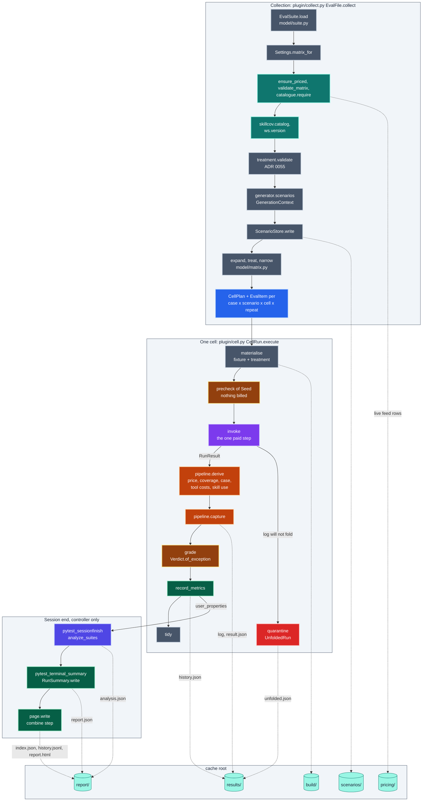

Every refusal on the left stops collection with a `pytest.UsageError` before any cell
spends: an unpriced or uncatalogued model, a rung the model ignores, a treatment that
copies nothing for a harness, a generator that raises, a scenario with no task to run, or
two scenarios under one id. A generator that yields nothing stops collection too, unless
it declares `may_be_empty` (`Promoted`, `Adversarial`), in which case collection warns by
name and collects no cell for that case.

</details>

## The package listing is the architecture

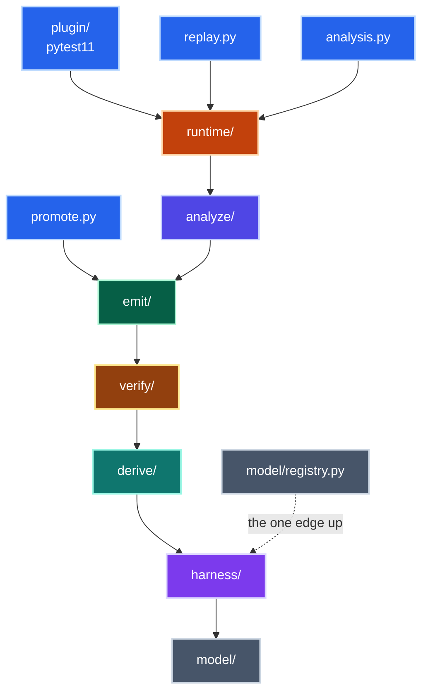

An arrow reads "may import". A layer may name any layer beneath it, never one above.

`src/pytest_xharness_eval/` is not a flat list of modules. Four entry points sit at the
root because something outside the package resolves them by name: `plugin/` through the
`pytest11` entry point (ADR 0014), and `replay.py`, `promote.py` and `analysis.py`
through `python -m`. The seven layers each run is pushed through are folders beneath
them. `plugin/` is itself a package: its `__init__` is the hook manifest, and each hook's
job (options, collection, the per-cell run, the record's crossing, the session-end
analysis, the summary) is a module beside it (ADR 0040).

| Layer | Answers | Depends on |
| --- | --- | --- |
| `model/` | what a run, a case, a scenario, a cell, a finding, a workspace and a cache tree *are* | nothing (except `model/registry.py`) |
| `harness/` | how one agent CLI is invoked, and how its session log folds | `model/` |
| `derive/` | what a folded run cost, and which of the skill it reached | `model/` |
| `verify/` | the shared `check_*` verifiers and the golden comparison a grader is written with | `model/`, `derive/` |
| `emit/` | the documents that leave: the metrics record, the report microsite, `analysis.json` | `model/`, `harness/` |
| `analyze/` | questions asked across cells, runs and subject versions | `model/`, `emit/` |
| `runtime/` | how a sweep is wired: settings, the cell plan, the steps after the CLI returns, the analyzer run | everything below |

The order is a rule, not a description: a ruff `TID251` rule in `pyproject.toml` bans
`harness`, `verify`, `emit`, `analyze` and `runtime` from every module beneath them, and
the per-file-ignore list there is the one place an exception is written (ADR 0039, ADR
0045). The one edge that points up is `model/registry.py`, which answers "which harnesses
exist" and "what is this one's shell vocabulary": both lookups by registered name, because
the registry is the only dispatch on a harness (ADR 0034). A second `TID251` rule bans
`harness.claude` and `harness.codex` outside `harness/`, so adding a CLI stays a one-file
job.

<details>
<summary>Detailed layer stack with the real import edges (20 nodes)</summary>

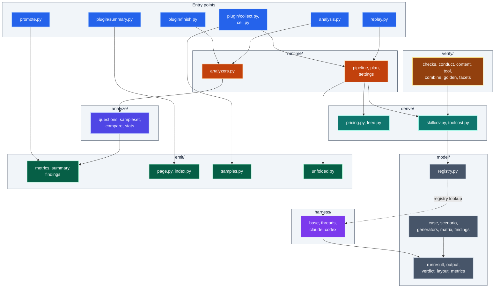

`runtime/analyzers.py` is the one module that names `analyze/`, and both the session-end
hook and the free command line go through it. `emit/unfolded.py` names `harness/base.py`
for the `Evidence` a quarantined run carries, which is why `emit/` sits above `harness/`.
The module names follow ADR 0076: `model/findings.py`, `analyze/questions.py`
(`Analysis`), `analyze/sampleset.py` (`Samples`), `emit/findings.py` (`AnalysisReport`).

</details>

## The event model: pytest hooks

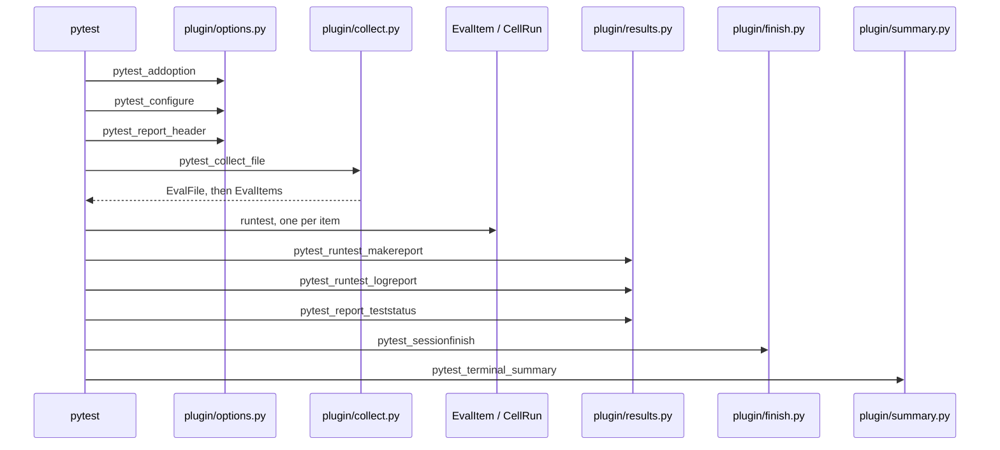

The plugin binds eight hooks in `plugin/__init__.py`, plus one more through the
`ResultCollector` it registers at configure. The record makes exactly one crossing from
a worker to the controller, as a plain mapping on `TestReport.user_properties`, because
execnet serialises builtins only (ADR 0016, ADR 0037). The analyzers run once, on the
controller, after every cell (ADR 0075).

<details>
<summary>Detailed event flow with the worker/controller split and files written</summary>

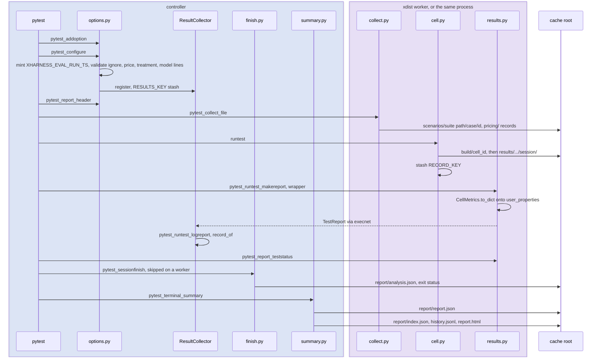

</details>

| Hook | Module | Consumes | Emits | Files written |
|------|--------|----------|-------|---------------|
| `pytest_addoption` | `plugin/options.py` | the parser | every `--` option (including `--xharness-repeat`) and `xharness_*` ini key | none |
| `pytest_configure` | `plugin/options.py` | ini lines | the run stamp in `XHARNESS_EVAL_RUN_TS` (inherited by xdist workers), the `RESULTS_KEY` stash, a registered `ResultCollector`; a `UsageError` on a malformed line | none |
| `pytest_report_header` | `plugin/options.py` | `Settings` | the skills root (marked `(missing)`), cache root, matrix and treatment source | none |
| `pytest_collect_file` | `plugin/collect.py` | an `eval_*.py` in `<skills root>/<skill>/evals/` | an `EvalFile`, whose `collect` yields one `EvalItem` per `CellPlan`: case, scenario, cell and repeat (`#k` under `--xharness-repeat`) | `<cache>/scenarios/<suite path>/<case>/<id>/` and `<id>.provenance.json`; `<cache>/pricing/` rows priced live |
| `runtest` (pytest's own call) | `plugin/collect.py`, `plugin/cell.py` | the item's plan | a `CellMetrics` in the item's `RECORD_KEY` stash; under `--dry-run` a free precheck and a skip | `<cache>/build/<cell>/`; `results/.../{session}/log.jsonl`, `result.json` or `unfolded.json`, `subagents/`, `history.json` |
| `pytest_runtest_makereport` | `plugin/results.py` | the stashed record | `("xharness_eval", dict)` plus flat `xharness_*` scalars on the call report (JUnit sees them too) | none |
| `pytest_runtest_logreport` | `ResultCollector` in `plugin/results.py` | a call report | the decoded record into `RESULTS_KEY`, by node id | none |
| `pytest_report_teststatus` | `plugin/results.py` | a call report | `PASSED`, `FAIL`, `ERROR` or `DRY-RUN` with the metrics status word | none |
| `pytest_sessionfinish` | `plugin/finish.py` | `RESULTS_KEY` (controller only; an xdist worker returns at once) | the `AnalysisReport` in `ANALYSIS_KEY`; `TESTS_FAILED` exit status if a finding failed and the session was otherwise OK | `report/analysis.json`, only when a graded suite declares an analyzer |
| `pytest_terminal_summary` | `plugin/summary.py` | `RESULTS_KEY`, `ANALYSIS_KEY` | the per-cell table, total spend, and the "agent eval analysis" section | `report/report.json`; then, if evidence was written, `index.json`, `history.jsonl`, `report.html`, `report.tokens.json`, the glossary |

## One live cell

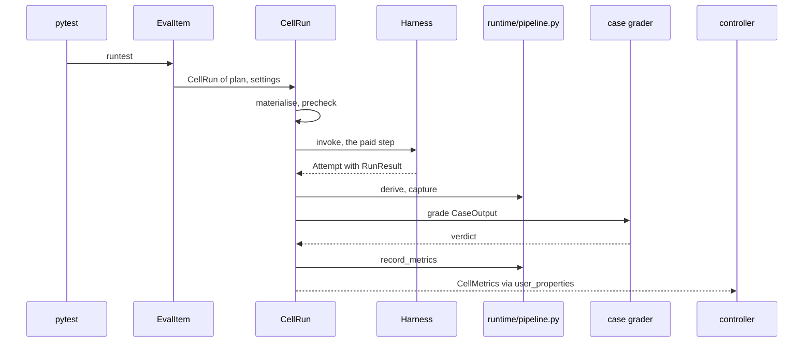

A cell is a (case, scenario, harness, model, effort, treatment) point, planned once at
collection into a frozen `CellPlan` (`runtime/plan.py`, ADR 0076) that the `EvalItem`
holds; `CellRun` is that plan plus the settings, and its only mutable state is the
verdict. Running it is always the same steps in `plugin/cell.py`. Exactly one,
`CellRun.invoke`, spawns a paid process and carries `pragma: no cover`; every other step
is exercised from captured logs in `tests/plugin/test_cell.py` (ADR 0002, ADR 0040). The
record is written in a `finally`, so a failing cell still emits its metrics; the
workspace is tidied in an outer `finally` (ADR 0062). Under `--xharness-repeat N` each
cell is planned N times as separate samples, named `#k`, each in its own `-r{k}`
workspace, and keyed as the same cell in every record (ADR 0075).

<details>
<summary>Detailed: collection, then the run</summary>

Collection runs once per suite, before any cell spends:

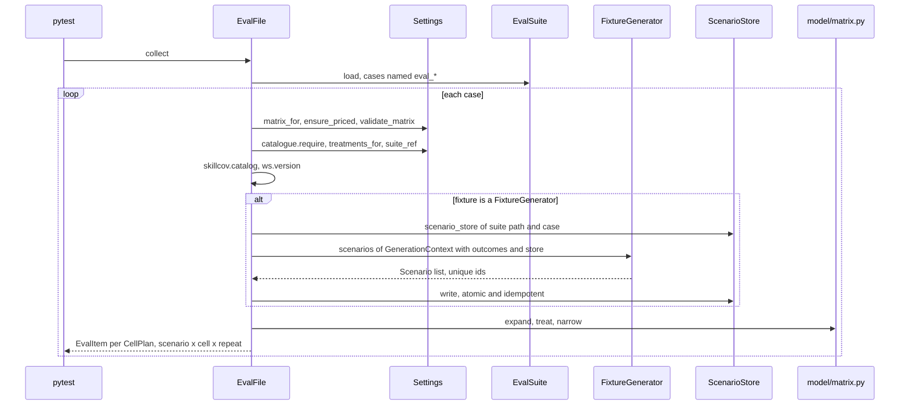

Then each item runs:

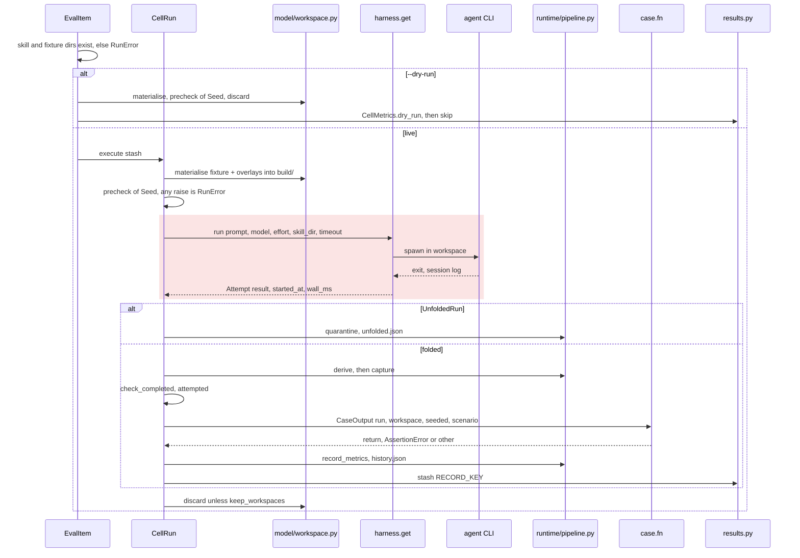

</details>

## Two CLIs, two capture contracts

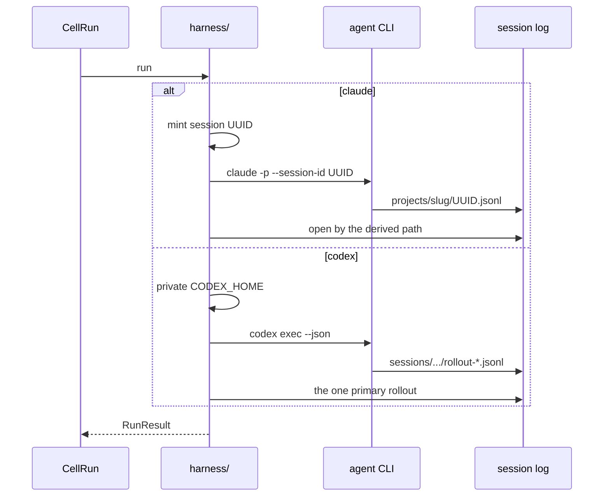

The Claude branch derives the log path before the process starts. The Codex branch
makes only one primary log possible. Both end in the same `RunResult`.

<details>
<summary>Detailed capture, including subagents and the unfolded path</summary>

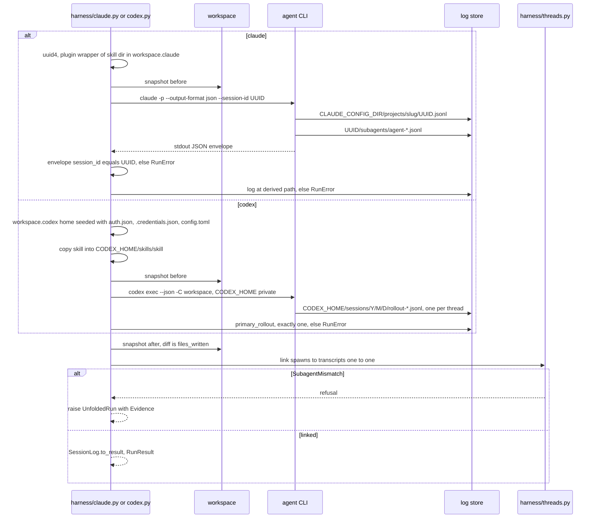

A run killed at the wall still folds: what the CLI wrote up to the kill is the run, and
it was billed. The harness marks it `timed_out_after_s`, with how long the logs had been
idle (ADR 0064).

</details>

The two CLIs give the harness different levers, so the correlation between a run and
its log is established in two different ways.

| Concern | Claude (`claude` 2.1.237) | Codex (`codex` 0.148.0) |
|---------|---------------------------|-------------------------|
| Headless invocation | `claude -p --output-format json` | `codex exec --json` |
| Log location | `~/.claude/projects/<cwd-slug>/<session-id>.jsonl` | `$CODEX_HOME/sessions/YYYY/MM/DD/rollout-<ts>-<id>.jsonl` |
| Subagent transcripts | `<session-id>/subagents/agent-*.jsonl` beside the log | one more rollout per spawned thread, under the same `CODEX_HOME` |
| Caller-chosen id | `--session-id <uuid>` | none |
| Correlation contract | derive the path from the UUID the harness minted | point `CODEX_HOME` at a private directory so exactly one primary rollout can exist |
| Cost in output | `total_cost_usd` on stdout, absent from the log | absent everywhere |
| Token accounting | per assistant message `usage` block, repeated on every content-block record of that message | one `token_count` event per model call: `last_token_usage` for the call, `total_token_usage` cumulative |
| Cache-write TTL | `usage.cache_creation.ephemeral_1h_input_tokens` / `ephemeral_5m_input_tokens` | not billed |

Two facts were learned from live runs and are encoded in `harness/claude.py` and
`harness/codex.py`, each beside the dialect it belongs to. First, Claude's cwd slug
replaces every non-alphanumeric character with `-`, including underscores. Second,
Codex's `input_tokens` already includes `cached_input_tokens`, so the cached share is
subtracted before pricing.

The Codex contract carries an accepted risk: `CODEX_HOME` is also where Codex keeps
its credentials, so the private directory is seeded with `auth.json`,
`.credentials.json` and `config.toml` before the run (ADR 0005).

Subagents are linked, not guessed: each harness's `spawns_in` reads its dialect's spawn
records, and `harness/threads.py` pairs them with transcripts one to one. Anything else
raises `SubagentMismatch`, which the harness wraps in `UnfoldedRun` with the `Evidence`
the cell needs to keep the billed logs (ADR 0072).

## Isolation keeps the score about the skill

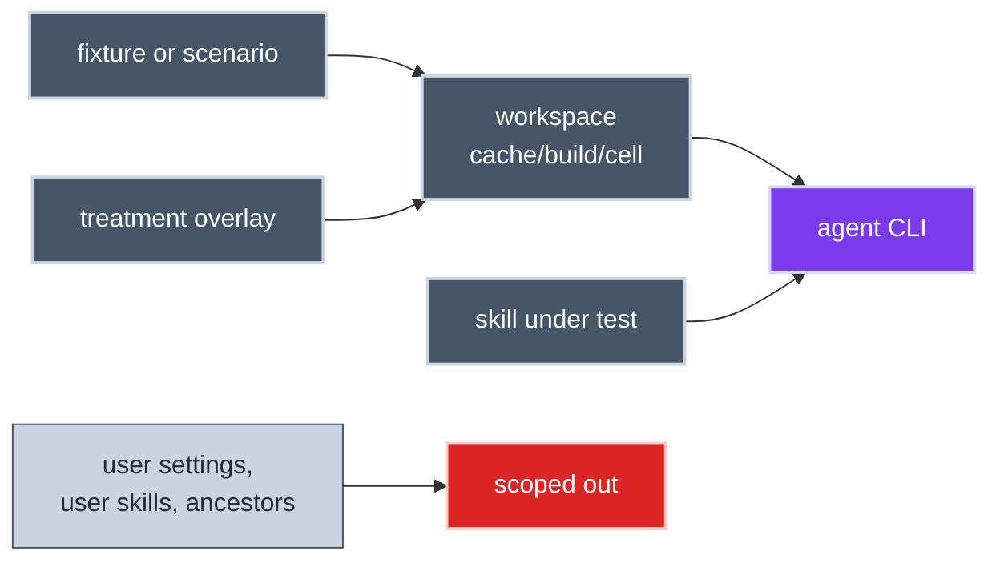

If the developer's own user-level skills or `CLAUDE.md` answer the prompt, the score
describes the developer's machine, not the skill under test. Each adapter therefore
scopes ambient configuration out and the skill under test in. A scenario case names no
skill, so nothing is registered and every harness is sent the same words (ADR 0074).

<details>
<summary>Detailed: each lever per harness (14 nodes)</summary>

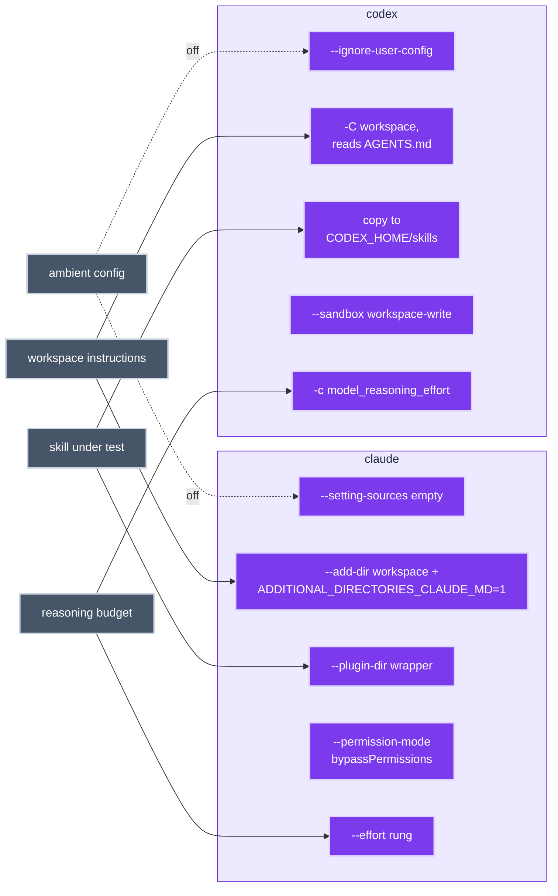

</details>

| Lever | Claude | Codex |
|-------|--------|-------|
| Ambient settings off | `--setting-sources ""` | `--ignore-user-config` |
| Working directory | process cwd, plus `--add-dir` | `-C <workspace>`, with `--skip-git-repo-check` (the workspace is no repository) |
| Skill under test in | `--plugin-dir <wrapper of skill dir>` | copied to `$CODEX_HOME/skills/<skill>` |
| Workspace instructions in, ancestors out | `--add-dir <workspace>` with `CLAUDE_CODE_ADDITIONAL_DIRECTORIES_CLAUDE_MD=1`: reads the workspace's `CLAUDE.md` alone | reads the workspace's `AGENTS.md` from its cwd |
| Permissions | `--permission-mode bypassPermissions` | `--sandbox workspace-write` |
| Reasoning budget | `--effort <rung>` | `-c model_reasoning_effort=<rung>` |

The reasoning-budget lever is the one that is *not* purely isolation: it is the third
matrix axis, so a cell either names a rung or deliberately names none and inherits the
CLI's own default. Both CLIs accept a rung they do not recognise and run at that default
anyway, so the rung is validated at collection rather than trusted at the flag (ADR 0049).

The workspace itself is a plain copy of the fixture tree (or a generated scenario's
stored tree) under `<cache>/build/`, rebuilt for every cell and removed, with the run
directories its harness made beside it, once the cell's evidence is captured and graded;
`--xharness-keep-workspaces` leaves it for inspection (ADR 0062). No git repository is
created, which puts git-dependent skills out of scope for now (ADR 0004). A treated cell
then has its treatment's directories copied over that copy, and the instructions lever
above is what makes each CLI actually read the overlaid file: `--setting-sources ""`
alone reads no `CLAUDE.md` at all, and `project` would also read the user's and every
ancestor's (ADR 0055).

## Data models

### Cases, scenarios and plans

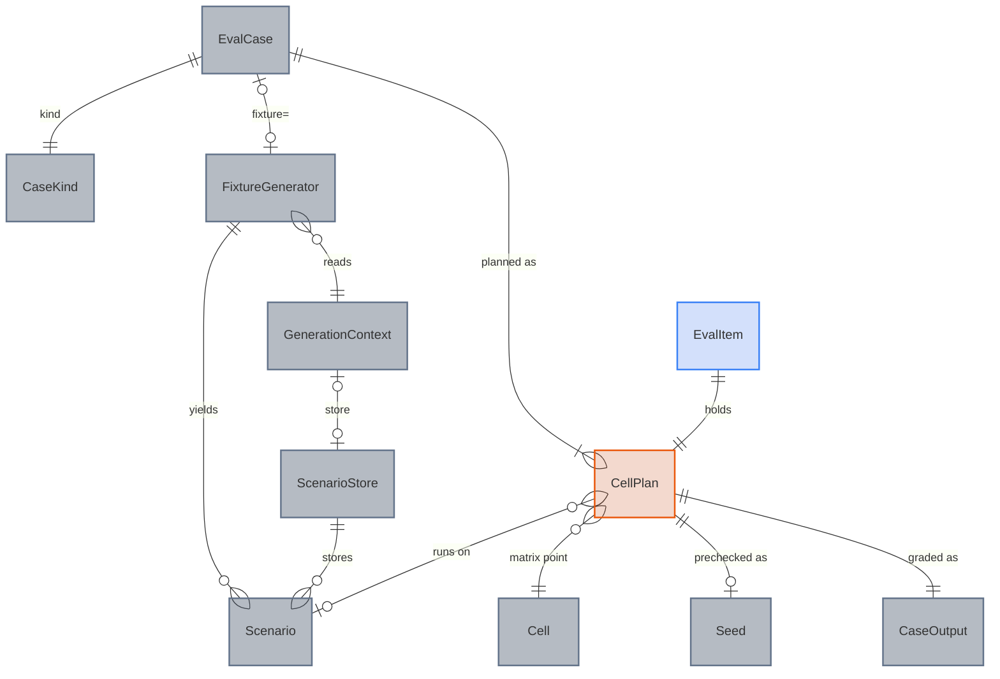

A case is either a *skill* case or a *scenario* case: `skill=None` sends the task
verbatim to every harness (ADR 0074). Its `fixture=` is a committed directory name or a
`FixtureGenerator`, whose scenarios each multiply the cells. A scenario's id is a slug
plus a digest of generator, version and canonical params, so it never renumbers; its
`expect` carries grader knobs that stay out of the id. A case's optional `precheck=` is
handed a `Seed` (the materialised workspace before anything runs) and gates the input,
not the agent.

<details>
<summary>Detailed: fields, the store, and the shipped generators (17 entities)</summary>

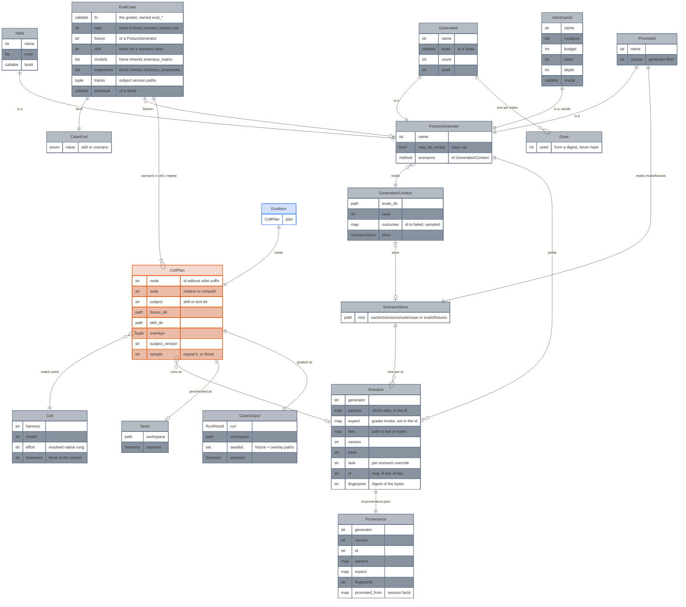

Sources: `model/case.py`, `model/scenario.py` (`Scenario`, `Provenance`,
`ScenarioStore`, `GenerationContext`, `FixtureGenerator`), `model/generators.py`,
`model/matrix.py`, `model/output.py` (`Seed`, `CaseOutput`), `runtime/plan.py`
(`CellPlan`), `plugin/collect.py`. A store is keyed by the suite path relative to the
project root (`Settings.suite_ref`), so two skills' `eval_main.py` never share one.
`ScenarioStore` is the one owner of the tree-plus-provenance layout, for the cache and for
a suite's promoted `evals/fixtures/` alike.

</details>

### The run record

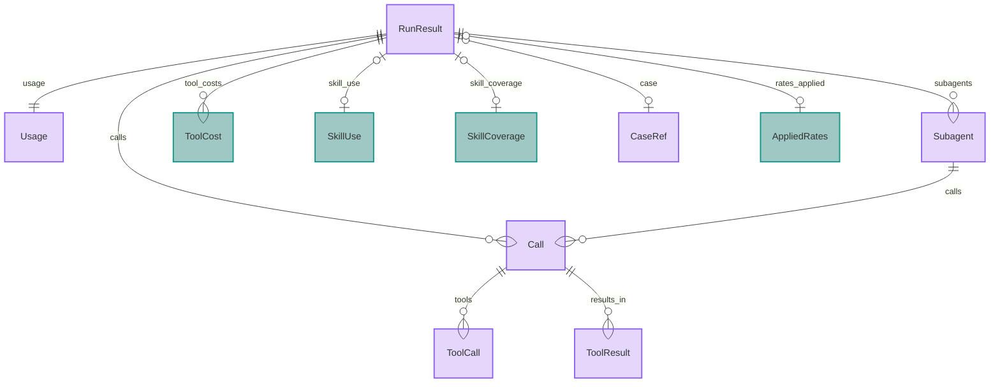

The harness folds the violet half from the session log; `runtime/pipeline.derive`
attaches the teal half, in one fixed order, for a live cell and a replay alike: price,
coverage, case, effort, treatment, catalogue facts, then tool costs and skill use last
(ADR 0034, ADR 0073). Written as `result.json`.

<details>
<summary>Detailed: fields (17 entities)</summary>

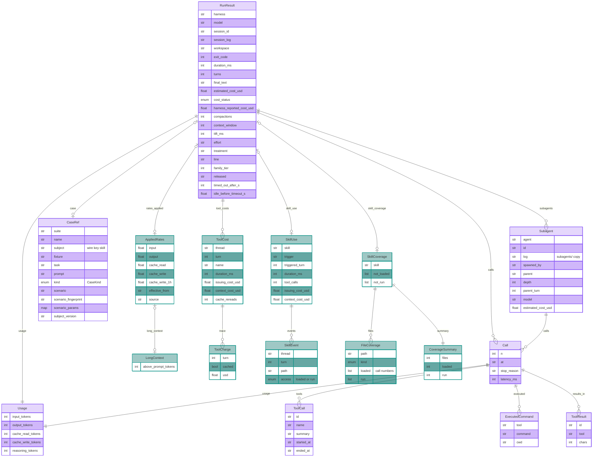

Sources: `model/runresult.py`, `derive/pricing.py`, `derive/toolcost.py`,
`derive/skillcov.py`. `CaseRef.subject` is the skill under test or a scenario case's tool
directory; it is written under the wire key `skill`, which every record has carried
since before a subject could be anything else. A scenario case has no skill under test,
so `skill_coverage` and `skill_use` are `None` (ADR 0074). Every field a grader may
assert on is listed in [docs/rollout.md](docs/rollout.md).

</details>

### The documents

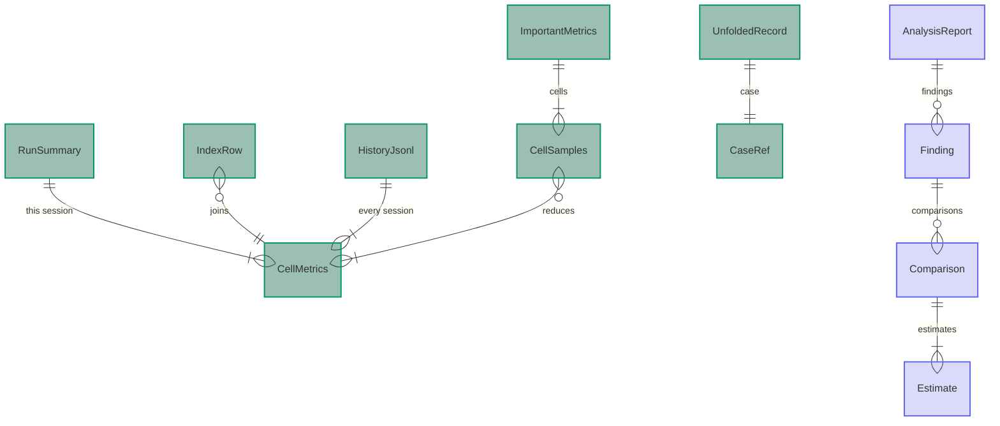

Every emitted format is a type in `emit/` with `to_dict` and `write` on it, so a reader
(and `report-ui/src/lib/types.ts`) has one definition to look at (ADR 0037, ADR 0040).
`CellMetrics` is the per-session record (`history.json`); `history.jsonl` is every one of
them sorted by `at`; `index.json` carries one `IndexRow` per captured session and, under
`important_metrics`, the per-cell samples (ADR 0071); `analysis.json` is one
`AnalysisReport` of every finding.

<details>
<summary>Detailed: fields and files (13 entities)</summary>

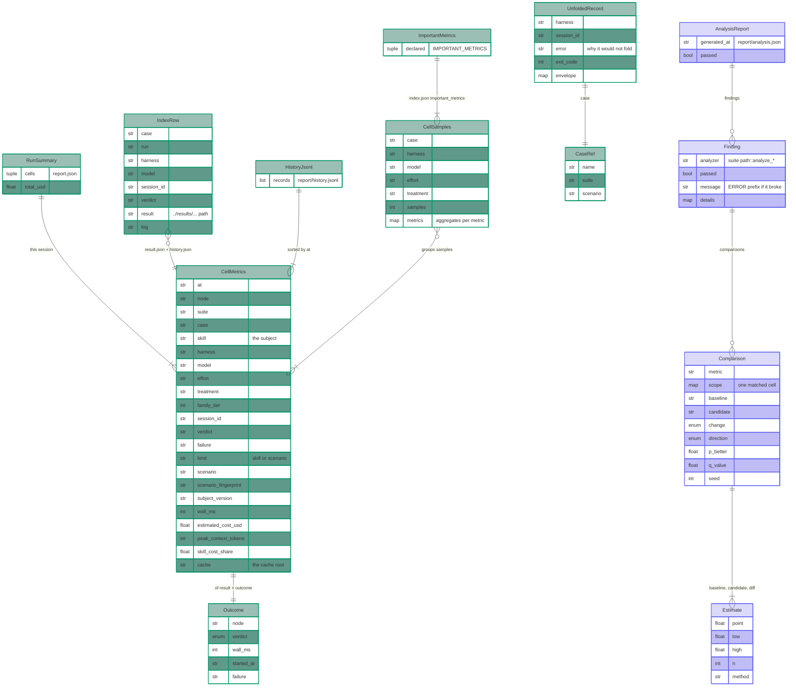

Sources: `emit/metrics.py` (its keys are a wire format, pinned in
`tests/emit/test_metrics.py`), `emit/summary.py`, `emit/index.py`, `emit/samples.py`,
`emit/unfolded.py`, `emit/findings.py`, `model/findings.py`. Each numeric `CellMetrics`
field declares its role (metric kind and which direction is better) as dataclass field
metadata under `ROLE_KEY` (`model/metrics.py`), so the Analyzer reads one declaration. An
`error` is never a sample of the pass rate, neither a pass nor a fail; it is counted by
the separate `errors` rate, where every graded sample counts.

</details>

### The cache tree

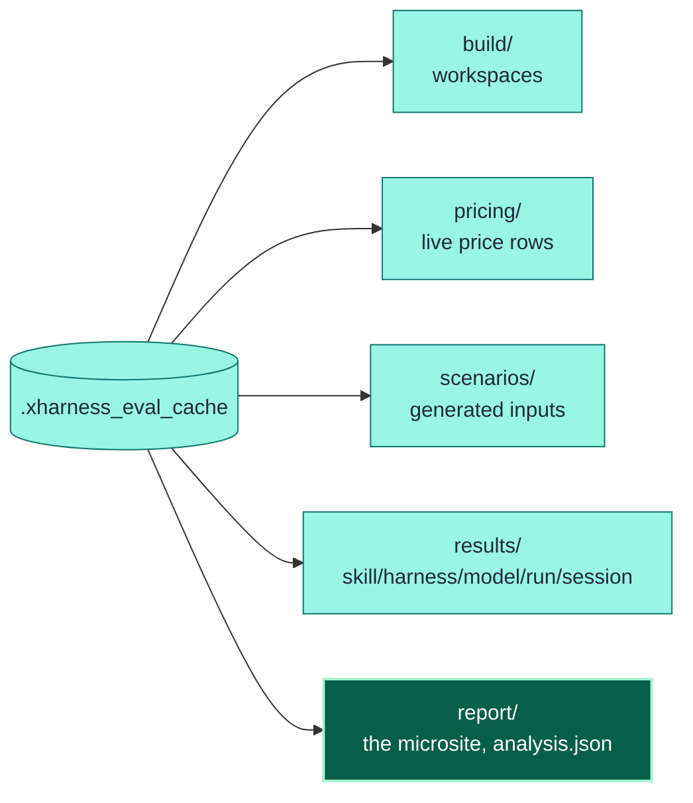

Every path under the cache root is named by `CacheLayout`, `SessionDir` and
`LocatedSession` in `model/layout.py` and nowhere else (ADR 0037, ADR 0038). Only
`CacheLayout` builds a `LocatedSession`, which is what a report link or a session key
needs, and `CacheLayout.holding(session_dir)` finds the cache a session directory sits in.
A cell writes only inside its own `{run}/{session}/`, so parallel workers never contend
(ADR 0032).

<details>
<summary>Detailed tree with the type that writes each file (25 nodes)</summary>

```mermaid
flowchart LR
    ROOT[(".xharness_eval_cache<br/>CacheLayout")]
    BUILD["build/cell_id/<br/>+ cell_id.claude, .codex"]
    PRICING["pricing/<br/>derive/feed.py"]
    SCN["scenarios/suite path/case/<br/>ScenarioStore"]
    SID["id/ tree"]
    SPROV["id.provenance.json<br/>Provenance"]
    RES["results/"]
    SK["skill/"]
    HA["harness/"]
    MO["model--effort--treatment/<br/>model_level"]
    RUN["run/<br/>YYYYMMDDTHHMMSSZ"]
    SES["session/<br/>LocatedSession"]
    LOG["log.jsonl"]
    RESULT["result.json<br/>RunResult"]
    UNF["unfolded.json<br/>UnfoldedRecord"]
    HIST["history.json<br/>CellMetrics"]
    SUBS["subagents/"]
    REP["report/"]
    SUMJ["report.json<br/>RunSummary"]
    IDX["index.json<br/>IndexRow + CellSamples"]
    HJL["history.jsonl"]
    PAGE["report.html"]
    TOK["report.tokens.json"]
    GLO["XHARNESS-REPORT-GLOSSARY.md"]
    ANJ["analysis.json<br/>AnalysisReport"]

    ROOT --> BUILD & PRICING & SCN & RES & REP
    SCN --> SID & SPROV
    RES --> SK --> HA --> MO --> RUN --> SES
    SES --> LOG & RESULT & UNF & HIST & SUBS
    REP --> SUMJ & IDX & HJL & PAGE & TOK & GLO & ANJ

    classDef store fill:#99f6e4,stroke:#0f766e,color:#1e293b,stroke-width:1px
    classDef adapter fill:#7c3aed,stroke:#ddd6fe,color:#fff,stroke-width:2px
    classDef emit fill:#065f46,stroke:#a7f3d0,color:#fff,stroke-width:2px
    classDef analyze fill:#4f46e5,stroke:#c7d2fe,color:#fff,stroke-width:2px
    classDef danger fill:#dc2626,stroke:#fecaca,color:#fff,stroke-width:2px
    class ROOT,BUILD,PRICING,SCN,SID,SPROV,RES,SK,HA,MO,RUN,SES,REP store
    class LOG,RESULT,SUBS adapter
    class HIST,SUMJ,IDX,HJL,PAGE,TOK,GLO emit
    class UNF danger
    class ANJ analyze
```

`{skill}` is the *subject*: the skill under test, or the tool directory a scenario case
exercises. Effort and treatment are coordinates but not levels: they join the model in
the level they share, so the five-level shape the report fetches by is unchanged (ADR
0049, ADR 0055). A repeat is not a coordinate either: each sample is its own session. A
session directory holds `result.json` or `unfolded.json`, never both.

</details>

## State machines

### A cell's verdict

```mermaid
stateDiagram-v2
    [*] --> Collected
    Collected --> DryRun : --dry-run, free precheck
    Collected --> Materialised : materialise
    Materialised --> Refused : precheck raises
    Materialised --> Invoked : invoke
    Invoked --> Quarantined : UnfoldedRun
    Invoked --> Graded : derive, capture
    Graded --> Recorded : pass, fail or error
    Refused --> [*] : error, nothing billed
    Quarantined --> [*] : error, no record
    DryRun --> [*] : skipped
    Recorded --> [*] : tidied

    classDef active fill:#2563eb,stroke:#bfdbfe,color:#fff,stroke-width:2px
    classDef bad fill:#dc2626,stroke:#fecaca,color:#fff,stroke-width:2px
    classDef done fill:#065f46,stroke:#a7f3d0,color:#fff,stroke-width:2px
    classDef skip fill:#e4e4e7,stroke:#52525b,color:#52525b,stroke-width:1px,stroke-dasharray:5 5
    class Collected,Materialised,Invoked,Graded active
    class Refused,Quarantined bad
    class Recorded done
    class DryRun skip
```

`CellRun.verdict` starts at `error`, because a run that has not reached its grader has
not passed. The words are `Verdict` in `model/verdict.py`: `pass`, `fail`, `error`,
`dry-run` (ADR 0041). One rule classifies every checker, a grader, a precheck or an
analyzer: `Verdict.of_exception` makes an `AssertionError` a `fail` and anything else,
an `Unmeasurable` included, an `error` (ADR 0076).

<details>
<summary>Detailed: every exit, and which one emits a record (18 states)</summary>

```mermaid
stateDiagram-v2
    [*] --> Collected
    Collected --> Missing : skill or fixture dir missing
    Collected --> DryRun : --dry-run, materialise, precheck, discard
    Collected --> Materialised : CellRun.materialise
    Materialised --> PrecheckRefused : precheck of Seed raises
    Materialised --> Invoked : invoke
    Invoked --> Refused : RunError, no envelope or log
    Invoked --> Quarantined : UnfoldedRun
    Invoked --> Stored : derive, capture
    Stored --> TimedOutActive : killed, active under 300s
    Stored --> Stalled : killed, idle 300s or more
    Stored --> NotAttempted : no model call
    Stored --> Grading : completed and attempted
    Grading --> Pass : grader returns
    Grading --> Fail : AssertionError
    Grading --> Error : anything else, Unmeasurable included
    TimedOutActive --> Fail
    Stalled --> Error
    NotAttempted --> Error
    Missing --> [*] : RunError, no record
    Pass --> Recorded
    Fail --> Recorded
    Error --> Recorded
    Recorded --> Tidied : discard workspace
    PrecheckRefused --> Tidied : RunError, nothing billed
    Refused --> Tidied
    Quarantined --> Tidied
    DryRun --> [*] : CellMetrics.dry_run, skip
    Tidied --> [*]

    note right of Recorded
        history.json written and
        RECORD_KEY stashed in a finally
    end note

    classDef active fill:#2563eb,stroke:#bfdbfe,color:#fff,stroke-width:2px
    classDef bad fill:#dc2626,stroke:#fecaca,color:#fff,stroke-width:2px
    classDef warn fill:#92400e,stroke:#fde68a,color:#fff,stroke-width:2px
    classDef done fill:#065f46,stroke:#a7f3d0,color:#fff,stroke-width:2px
    classDef skip fill:#e4e4e7,stroke:#52525b,color:#52525b,stroke-width:1px,stroke-dasharray:5 5
    class Collected,Materialised,Invoked,Stored,Grading active
    class Missing,PrecheckRefused,Refused,Quarantined,Stalled,NotAttempted,Error bad
    class TimedOutActive,Fail warn
    class Pass,Recorded,Tidied done
    class DryRun skip
```

A cell refused before `store` raises without a metrics record, and pytest reports it as
an error: a missing skill or fixture directory from `EvalItem.runtest`; a precheck that
refused the seed (whatever it raised, an assertion included, is the fixture's fault, so
it is a `RunError` and nothing is billed); a CLI that left no envelope or log, or a log
that would not fold, from `CellRun.execute`. A killed run that was still active is a
`fail` (a longer `xharness_timeout_s` might pass it); one silent for `STALLED_AFTER_S`
is an `error` to investigate (ADR 0064). A run that never reached the model is an
`error`, never graded (ADR 0063).

</details>

### A session capture

```mermaid
stateDiagram-v2
    [*] --> Spawned
    Spawned --> Folded : to_result
    Spawned --> Unfolded : SubagentMismatch
    Folded --> Captured : result.json, history.json
    Unfolded --> Quarantined : unfolded.json
    Captured --> Captured : replay rebuild
    Quarantined --> Captured : replay folds it
    Quarantined --> Quarantined : still refused

    classDef active fill:#2563eb,stroke:#bfdbfe,color:#fff,stroke-width:2px
    classDef bad fill:#dc2626,stroke:#fecaca,color:#fff,stroke-width:2px
    classDef done fill:#065f46,stroke:#a7f3d0,color:#fff,stroke-width:2px
    class Spawned,Folded active
    class Unfolded,Quarantined bad
    class Captured done
```

A billed run is never lost: a log the harness will not fold is kept with its transcripts
and the reason, and a later replay retries it (ADR 0072).

<details>
<summary>Detailed: what each state holds on disk (9 states)</summary>

```mermaid
stateDiagram-v2
    [*] --> Spawned
    Spawned --> Folded : SessionLog.to_result
    Spawned --> Unfolded : UnfoldedRun with Evidence
    Folded --> Derived : pipeline.derive
    Derived --> Captured : capture, log.jsonl, subagents/, result.json
    Captured --> Recorded : record_metrics, history.json
    Unfolded --> Quarantined : log.jsonl, subagents/, unfolded.json
    Recorded --> Indexed : page.write reads it
    Quarantined --> Skipped : the report ignores a partial capture
    Indexed --> Recorded : replay rewrites result and history
    Skipped --> Recorded : replay folds, unfolded.json deleted
    Skipped --> Skipped : replay still refuses, raises after the rest

    classDef active fill:#2563eb,stroke:#bfdbfe,color:#fff,stroke-width:2px
    classDef bad fill:#dc2626,stroke:#fecaca,color:#fff,stroke-width:2px
    classDef done fill:#065f46,stroke:#a7f3d0,color:#fff,stroke-width:2px
    classDef skip fill:#e4e4e7,stroke:#52525b,color:#52525b,stroke-width:1px,stroke-dasharray:5 5
    class Spawned,Folded,Derived active
    class Unfolded,Quarantined bad
    class Captured,Recorded,Indexed done
    class Skipped skip
```

A quarantined capture has no `history.json`, so a replay that folds it writes the
`result.json` but has no live verdict to rebuild a metrics record around.

</details>

### An adversarial scenario

```mermaid
stateDiagram-v2
    [*] --> Mutant : explore, drawn from a seed
    Mutant --> Discarded : taken, duplicate or screened out
    Mutant --> Stored : kept
    Stored --> Run
    Run --> Passed
    Run --> Failed
    Failed --> Confirming : next sweep
    Confirming --> Promoted : promote CLI
    Promoted --> Regression : Promoted generator

    classDef active fill:#2563eb,stroke:#bfdbfe,color:#fff,stroke-width:2px
    classDef bad fill:#dc2626,stroke:#fecaca,color:#fff,stroke-width:2px
    classDef done fill:#065f46,stroke:#a7f3d0,color:#fff,stroke-width:2px
    classDef skip fill:#e4e4e7,stroke:#52525b,color:#52525b,stroke-width:1px,stroke-dasharray:5 5
    class Mutant,Stored,Run,Confirming active
    class Failed bad
    class Promoted,Regression,Passed done
    class Discarded skip
```

`Adversarial` in `model/generators.py` spends a small paid budget where the subject
already breaks, and a free oracle decides which mutants are worth a run at all (ADR
0074). Promotion writes bytes, not parameters, so a regression fixture never drifts with
the generator that found it.

<details>
<summary>Detailed: confirm, explore, screen, promote (13 states)</summary>

```mermaid
stateDiagram-v2
    [*] --> Seed : seeds.scenarios
    Seed --> Mutant : explore, parent weighted f+1 over n+2 by lineage
    Mutant --> Discarded : id already sampled or confirmed
    Mutant --> Discarded : same fingerprint as parent or a kept mutant
    Mutant --> Discarded : oracle signals empty or seen this sweep
    Mutant --> Stored : ScenarioStore.write, params plus mutation record
    Stored --> Run : one cell per matrix point
    Run --> Passed : verdict pass
    Run --> Failed : verdict fail
    Run --> Uncounted : verdict error, says nothing
    Failed --> Confirming : stored and failed, up to half the budget, worst first
    Confirming --> Failed : fails again
    Confirming --> Passed : passes
    Failed --> Promoted : python -m pytest_xharness_eval.promote
    Promoted --> Regression : Promoted yields it from evals/fixtures
    Regression --> Broken : bytes no longer match fingerprint
    Regression --> Run : every sweep
    Seed --> Exhausted : nothing new, nothing failed
    Exhausted --> [*] : may_be_empty, collection warns

    note right of Promoted
        evals/fixtures/name/ plus
        name.provenance.json beside it
    end note

    classDef active fill:#2563eb,stroke:#bfdbfe,color:#fff,stroke-width:2px
    classDef bad fill:#dc2626,stroke:#fecaca,color:#fff,stroke-width:2px
    classDef done fill:#065f46,stroke:#a7f3d0,color:#fff,stroke-width:2px
    classDef skip fill:#e4e4e7,stroke:#52525b,color:#52525b,stroke-width:1px,stroke-dasharray:5 5
    class Seed,Mutant,Stored,Run,Confirming active
    class Failed,Broken bad
    class Passed,Promoted,Regression done
    class Discarded,Uncounted,Exhausted skip
```

Each sweep yields at most `budget` scenarios: confirm first (past mutants that failed and
are still stored, re-run from their bytes), then explore with what is left. Explore draws
are salted with the number of mutants already sampled (the generation), so each sweep
searches somewhere new; a parent's weight counts the samples of every stored mutant bred
from it (`ScenarioStore.lineage`). A mutant's `params` are its parent's plus a `mutation`
record (parent, mutators, generation, attempt), and its `expect` is its parent's. The
search is deterministic for a given history, seed and generator code: every `Draw` seeds
from a digest, never `hash()`. History reaches the generator as
`GenerationContext.outcomes`, built by `emit/samples.scenario_outcomes`, which counts a
`fail` as failed and ignores an `error`. When to promote is a human decision; the confirm
pass exists so one unlucky sample is not promoted as a regression.

</details>

### A comparison's outcome

```mermaid
stateDiagram-v2
    [*] --> Matched : same cell in both arms
    Matched --> Insufficient : n below min_n
    Matched --> Tested : enough samples
    Tested --> Inconclusive : not clear
    Tested --> Improved : clear, better
    Tested --> Regressed : clear, worse

    classDef active fill:#2563eb,stroke:#bfdbfe,color:#fff,stroke-width:2px
    classDef bad fill:#dc2626,stroke:#fecaca,color:#fff,stroke-width:2px
    classDef done fill:#065f46,stroke:#a7f3d0,color:#fff,stroke-width:2px
    classDef skip fill:#e4e4e7,stroke:#52525b,color:#52525b,stroke-width:1px,stroke-dasharray:5 5
    class Matched,Tested active
    class Regressed bad
    class Improved done
    class Insufficient,Inconclusive skip
```

`Change` in `model/findings.py` has four words and no fifth. A tiny sample is
`insufficient`, never a coin-flip "improved"; anything the evidence does not settle is
`inconclusive`, which is the default.

<details>
<summary>Detailed: the tests, the correction and the gate (11 states)</summary>

```mermaid
stateDiagram-v2
    [*] --> Versions : expect_no_regression, no sides named
    Versions --> GateFailed : fewer than 2 subject versions
    Versions --> Grouped : baseline, candidate = last two versions
    Grouped --> Matched : key present in both arms, by CELL_FIELDS
    Matched --> Insufficient : either arm under min_n, default 3
    Matched --> Tested : Fisher exact for a rate, permutation otherwise
    Tested --> Corrected : Benjamini-Hochberg q across all scopes
    Corrected --> Inconclusive : q over alpha or the diff CI spans 0
    Corrected --> Improved : clear, in the metric's direction
    Corrected --> Regressed : clear, against it
    Regressed --> GateFailed : any cell regressed
    Insufficient --> GateFailed : every cell insufficient
    Inconclusive --> GatePassed
    Improved --> GatePassed
    GateFailed --> [*] : AnalysisFailure, a failed finding
    GatePassed --> [*] : comparisons returned

    classDef active fill:#2563eb,stroke:#bfdbfe,color:#fff,stroke-width:2px
    classDef bad fill:#dc2626,stroke:#fecaca,color:#fff,stroke-width:2px
    classDef done fill:#065f46,stroke:#a7f3d0,color:#fff,stroke-width:2px
    classDef skip fill:#e4e4e7,stroke:#52525b,color:#52525b,stroke-width:1px,stroke-dasharray:5 5
    class Versions,Grouped,Matched,Tested,Corrected active
    class Regressed,GateFailed bad
    class Improved,GatePassed done
    class Insufficient,Inconclusive skip
```

Sources: `analyze/compare.py` (`compare`, `_decide`), `analyze/stats.py`,
`analyze/questions.py` (`expect_no_regression`). A gate that cannot see a regression must
not report that there was none, so it fails on a single recorded version and when no
matched cell had `min_n` samples on both sides. Alpha is `1 - confidence` (default
0.95), every draw is seeded, and a comparison is only ever made between samples of the
same cell. `--xharness-repeat` is how a sweep reaches `min_n`.

</details>

## Session end: analyze and combine

```mermaid
sequenceDiagram
    participant PY as pytest
    participant FIN as plugin/finish.py
    participant RA as runtime/analyzers.py
    participant SUM as plugin/summary.py
    participant PG as emit/page.py

    PY->>FIN: pytest_sessionfinish, controller only
    FIN->>RA: analyze_suites of the graded suites
    RA-->>FIN: AnalysisReport, or None
    FIN->>FIN: write analysis.json, fail the session on a failed finding
    PY->>SUM: pytest_terminal_summary
    SUM->>SUM: table, report.json
    SUM->>PG: write for each cache root
    SUM->>SUM: agent eval analysis section
```

The analyzers run once per session, on the controller, over every stored record plus
this sweep's (ADR 0075). Only suites that graded a live cell this session are analyzed,
and a session whose suites declare no `analyze_*` writes no `analysis.json`. A failed
finding turns an otherwise passing session into `TESTS_FAILED`. The same run is free from
the command line: `python -m pytest_xharness_eval.analysis <cache> [--suite ...] [--seed N]`
calls the same `analyze_suites` over every suite under the skills root and exits 1 on a
failed finding.

The combine step is per cache root, not per cell: it rebuilds one browsable report over
everything under `results/`, every subject and every run, not only this session's (ADR
0032). A session that wrote no evidence names no root and combines nothing, which is how
`--dry-run` stays free.

<details>
<summary>Detailed: the analyzer run and the combine step</summary>

```mermaid
sequenceDiagram
    participant FIN as finish.py
    participant RA as analyzers.py
    participant SU as EvalSuite
    participant AN as analyze.run_one
    participant SUM as summary.py
    participant PG as page.write
    participant FS as report/

    FIN->>FIN: return on an xdist worker
    FIN->>FIN: live records with a cache and a suite, else return
    FIN->>RA: settings, suite paths, live records
    RA->>SU: load each suite, its AnalyzerSpecs
    RA->>RA: Samples.stored of the cache, Samples.of current
    loop each suite, each analyze_*
        RA->>AN: spec over Analysis scoped to the suite
        AN-->>RA: Finding, passed, failed, or ERROR for a broken analyzer
    end
    RA-->>FIN: AnalysisReport, findings named suite::analyzer
    FIN->>FS: analysis.json
    FIN->>FIN: ANALYSIS_KEY, exit status
    SUM->>FS: report.json
    SUM->>PG: cache, design tokens, inline
    PG->>FS: index.json with important_metrics, history.jsonl
    PG->>FS: report.html, report.tokens.json, glossary
    SUM->>SUM: print finding_lines
```

A broken analyzer (one that raises anything but a failed assertion) is reported as a
failed finding whose message starts `ERROR` and names the exception: never swallowed,
never an `INTERNALERROR`, and the other analyzers and the combine step still run.

</details>

## Replay

```mermaid
sequenceDiagram
    participant U as developer
    participant RP as replay.py
    participant H as harness.get
    participant PL as runtime/pipeline.py
    participant PG as emit/page.py

    U->>RP: python -m pytest_xharness_eval.replay cache
    loop every session under results/
        RP->>H: session_from_capture, to_result
        RP->>PL: derive, same order as live
        RP->>PL: record_metrics, keeps the live verdict
    end
    RP->>PG: write, the combine step
```

`replay.py` rebuilds every `result.json` and `history.json` from the captured
`log.jsonl`, re-prices each at the record in effect on its `{run}` day (ADR 0050), and
runs the combine step. No CLI runs and nothing is spent. Pointed at a legacy
`<skill>/evals/captured` directory, it migrates that evidence first
(`runtime/legacy.py`, ADR 0040).

<details>
<summary>Detailed replay, including the quarantine retry</summary>

```mermaid
sequenceDiagram
    participant RP as replay.rebuild
    participant ST as Settings.from_cache
    participant CL as CacheLayout.sessions
    participant H as Harness
    participant PL as pipeline
    participant FS as session dir

    RP->>ST: prices, ignore lines, catalogue
    RP->>CL: walk results/
    loop each LocatedSession
        alt result.json
            RP->>FS: read stored result
        else only unfolded.json
            RP->>FS: read unfolded record, retrying
        end
        RP->>H: session_from_capture, to_result
        RP->>RP: carry case, effort, treatment, timeout forward
        RP->>PL: derive at run_date, scenario case has no skill
        alt SubagentMismatch while retrying
            RP->>RP: note it, continue
        else folded
            RP->>FS: write result.json, delete unfolded.json
            RP->>PL: record_metrics with the stored Outcome
        end
    end
    RP->>RP: page.write
    RP->>RP: raise RunError if any capture still refuses
```

What the log cannot say is carried forward from the stored result: the case (or
recovered from the suite by `model/suite.find_case`), the effort rung, the treatment,
the catalogue facts and a kill at the wall (ADR 0025, ADR 0049, ADR 0055, ADR 0057,
ADR 0064).

</details>

## Promote

```mermaid
sequenceDiagram
    participant U as developer
    participant PR as promote.py
    participant SS as ScenarioStore
    participant FX as evals/fixtures

    U->>PR: python -m pytest_xharness_eval.promote source evals
    PR->>SS: Scenario.promoted, fingerprint checked
    PR->>FX: copy bytes to fixtures/name/
    PR->>FX: name.provenance.json beside it
```

`promote.py` freezes a generated scenario into a committed regression fixture (ADR
0074). The provenance file sits *beside* the fixture, never inside it, because anything
inside a fixture is copied into every workspace (ADR 0018).

<details>
<summary>Detailed: promoting from a failed session</summary>

```mermaid
sequenceDiagram
    participant PR as promote.promote
    participant SD as results/.../session
    participant CL as CacheLayout
    participant SS as ScenarioStore
    participant FX as evals/fixtures

    alt source holds result.json
        PR->>SD: read CaseRef from result.json
        SD-->>PR: suite, case name, scenario id
        PR->>SD: CellMetrics.stored, history.json
        SD-->>PR: verdict, failure
        PR->>CL: holding of the session dir
        PR->>SS: scenario_store of suite and case, stored by id
    end
    PR->>SS: Scenario.promoted, tree and Provenance
    SS-->>PR: ValueError if the bytes changed
    PR->>FX: FileExistsError if name exists
    PR->>FX: write tree to fixtures/name/
    PR->>FX: Provenance with promoted_from session facts
```

A session that ran on a committed fixture has nothing to promote, and says so. A suite
then runs every promoted fixture through the `Promoted` generator. A regression case is
declared before its first promotion, so `Promoted` may yield nothing; collection then
warns by name rather than collecting a silent green case.

</details>

## Pricing is the plugin's job, not the CLI's

```mermaid
flowchart LR
    RR["RunResult<br/>per-call ledgers"]
    TBL["PriceTable<br/>harness, model, day"]
    TIER["tier per call<br/>long_context?"]
    COST["estimated_cost_usd<br/>cost_by_tier"]
    STOP["unpriced model<br/>stops collection"]

    RR --> TIER
    TBL --> TIER --> COST
    TBL -.->|no row| STOP

    classDef adapter fill:#7c3aed,stroke:#ddd6fe,color:#fff,stroke-width:2px
    classDef derive fill:#0f766e,stroke:#99f6e4,color:#fff,stroke-width:2px
    classDef emit fill:#065f46,stroke:#a7f3d0,color:#fff,stroke-width:2px
    classDef danger fill:#dc2626,stroke:#fecaca,color:#fff,stroke-width:2px
    class RR adapter
    class TBL,TIER derive
    class COST emit
    class STOP danger
```

Neither session log carries cost. Claude reports `total_cost_usd` on its stdout
envelope; Codex reports nothing. The plugin therefore prices every run itself
(`derive/pricing.py`), and an unpriced model stops the sweep at collection, before any
money is spent (ADR 0007). The `--dry-run` option exercises the same check without a CLI.

<details>
<summary>Detailed: where rates come from, and how a call is priced (12 nodes)</summary>

```mermaid
flowchart TB
    subgraph SRC["Rate sources, layered"]
        BUND["derive/prices/<br/>prices-YYYYMMDD.toml"]
        INI["xharness_prices<br/>ini lines"]
        LIVE["cache/pricing/<br/>ensure_priced from the feed"]
    end
    TABLE["PriceTable.resolve<br/>harness, model, run day"]
    REFUSE["PricingError<br/>never zero, never a neighbour"]
    PRIM["primary calls<br/>at the run's model"]
    SUB["subagent calls<br/>at their own model"]
    THR["prompt over<br/>above_prompt_tokens?"]
    BASE["base rates"]
    LONG["long_context rates"]
    TIERS["5 tiers: input, output,<br/>cache_read, write 5m, write 1h"]
    OUT["estimated_cost_usd,<br/>cost_by_tier, rates_applied"]

    BUND & INI & LIVE --> TABLE
    TABLE -.->|no row for that day| REFUSE
    TABLE --> PRIM & SUB --> THR
    THR -->|no| BASE --> TIERS
    THR -->|yes| LONG --> TIERS
    TIERS --> OUT

    classDef derive fill:#0f766e,stroke:#99f6e4,color:#fff,stroke-width:2px
    classDef store fill:#99f6e4,stroke:#0f766e,color:#1e293b,stroke-width:1px
    classDef adapter fill:#7c3aed,stroke:#ddd6fe,color:#fff,stroke-width:2px
    classDef emit fill:#065f46,stroke:#a7f3d0,color:#fff,stroke-width:2px
    classDef danger fill:#dc2626,stroke:#fecaca,color:#fff,stroke-width:2px
    classDef sg fill:#ccfbf1,stroke:#0f766e,color:#1e293b
    class BUND,INI,LIVE store
    class TABLE,THR,BASE,LONG,TIERS derive
    class PRIM,SUB adapter
    class OUT emit
    class REFUSE danger
    class SRC sg
```

</details>

The bundled records are `derive/prices/prices-YYYYMMDD.toml`, one per interval: each
states `effective_from` (and `effective_to` once superseded), groups its rows by harness,
and states every rate in USD per million tokens, the unit providers publish. A row is
found by `(harness, model, day)`, where the day is the session's `{run}` stamp, so a live
cell and a replay of it choose the same row and an old capture is never re-priced at
today's rate (ADR 0050). A project layers its own `xharness_prices` lines over them, and a
model with no row at all is priced live from LiteLLM's feed into `<cache>/pricing/` at
collection, exact first-party ids only (ADR 0060).

A row carries five tiers: input, output, cache read, cache write (five-minute) and cache
write (one-hour); a row that states no one-hour rate gets the five-minute rate times 1.6.
A row may also carry a `long_context` tier: a threshold in prompt tokens and five higher
rates, billed for the whole call once that call's prompt (input plus both cache tiers)
exceeds it. The threshold belongs to one request, so pricing walks the per-call ledgers,
primary and subagent, and prices each call at the tier its own prompt selects; a run's
summed usage is never compared with it (ADR 0051). Each subagent's calls are priced at
the rates of the model that answered them, not the parent's (ADR 0065). The records are
curated by `.github/scripts/curate_prices.py` (`make prices`) from LiteLLM's feed,
first-party rows only, with every published rate modelled or the run refused.

Keeping the cache tiers separate matters. In the reference Codex run, 174,336 of
202,639 tokens were cache reads. Priced flat at the input rate the run would report
about USD 0.25; priced by tier it reports USD 0.07. The `Usage` dataclass keeps the
tiers apart for that reason.

Claude's own `total_cost_usd` is kept as `harness_reported_cost_usd`, a reconciliation
oracle. Treat absolute figures as approximate and relative comparison across cells as
robust; the derivation and its provider sources are
[docs/token-accounting.md](docs/token-accounting.md).

## Grading and analysis are not prescribed

```mermaid
flowchart LR
    SEED["Seed"]
    PRE["precheck"]
    OUT["CaseOutput"]
    CHK["verify/ checkers<br/>check_*, check_all"]
    GOLD["verify/golden.py<br/>facets + tolerances"]
    VER["cell verdict<br/>Verdict.of_exception"]
    REC["stored records"]
    ANA["Analysis<br/>analyze/"]
    FIND["Finding"]

    SEED --> PRE
    OUT --> CHK --> VER
    OUT --> GOLD --> VER
    VER --> REC --> ANA --> FIND

    classDef domain fill:#475569,stroke:#cbd5e1,color:#fff,stroke-width:2px
    classDef verify fill:#92400e,stroke:#fde68a,color:#fff,stroke-width:2px
    classDef emit fill:#065f46,stroke:#a7f3d0,color:#fff,stroke-width:2px
    classDef analyze fill:#4f46e5,stroke:#c7d2fe,color:#fff,stroke-width:2px
    class SEED,OUT domain
    class PRE,CHK,GOLD verify
    class VER,REC emit
    class ANA,FIND analyze
```

The plugin does not decide what a correct run looks like. A case is an ordinary
Python function that receives one `CaseOutput` (the run record, the workspace the agent
wrote, the seeded paths, and the scenario if one was generated) and composes whatever
checks it needs with plain `assert` (ADR 0045). A `precheck=` does the same for the input:
it is handed the `Seed` before the run and refuses a fixture that no longer reproduces
what the case is about. The checks every case was writing for itself ship as `verify/`,
and a case still writes its own beside it (ADR 0012, ADR 0013). Where a correct answer
can be written down, `verify/golden.py` compares against a committed one facet by facet,
each facet declaring how much variation is still correct (ADR 0046).

<details>
<summary>Detailed: the checker modules, and the Analyzer's API (17 nodes)</summary>

```mermaid
flowchart TB
    OUT["CaseOutput<br/>model/output.py"]
    subgraph VERIFY["verify/: one cell"]
        CHECKS["checks.py<br/>check_rollout, files, skill loaded"]
        CONDUCT["conduct.py<br/>cost, wall, context, tools, skill, subagents"]
        CONTENT["content.py<br/>kept, length, hidden, fences, ids"]
        TOOL["tool.py<br/>run_tool, check_tool_clean, require_seed_fails"]
        COMB["combine.py<br/>check_all, every failure"]
        GOLD["golden.py, tolerance.py, facets.py"]
    end
    FAIL["AssertionError<br/>fail"]
    ERR["Unmeasurable<br/>error"]
    subgraph ANALYZE["analyze/: across cells and runs"]
        SAM["sampleset.py Samples<br/>where, group, latest"]
        AN["questions.py Analysis<br/>history + current"]
        ENV["summarise, effects,<br/>best, pareto, tiers, reliability"]
        SUBJ["compare, trend, regressions,<br/>fragile, broken"]
        EXP["expect_no_regression,<br/>expect_at_least, at_most,<br/>pareto_contains"]
        STATS["stats.py<br/>Wilson, bootstrap,<br/>permutation, BH"]
    end
    FIND["Finding"]
    REPORT["AnalysisReport<br/>analysis.json"]

    OUT --> CHECKS & CONDUCT & CONTENT & TOOL & GOLD
    COMB --> CHECKS & CONDUCT & CONTENT & TOOL
    CHECKS & CONDUCT & CONTENT & GOLD --> FAIL
    TOOL & CONDUCT --> ERR
    SAM --> AN --> ENV & SUBJ
    ENV & SUBJ --> STATS
    SUBJ --> EXP --> FIND --> REPORT

    classDef domain fill:#475569,stroke:#cbd5e1,color:#fff,stroke-width:2px
    classDef verify fill:#92400e,stroke:#fde68a,color:#fff,stroke-width:2px
    classDef analyze fill:#4f46e5,stroke:#c7d2fe,color:#fff,stroke-width:2px
    classDef danger fill:#dc2626,stroke:#fecaca,color:#fff,stroke-width:2px
    classDef emit fill:#065f46,stroke:#a7f3d0,color:#fff,stroke-width:2px
    classDef sgv fill:#fef3c7,stroke:#b45309,color:#1e293b
    classDef sga fill:#e0e7ff,stroke:#4338ca,color:#1e293b
    class OUT domain
    class CHECKS,CONDUCT,CONTENT,TOOL,COMB,GOLD verify
    class SAM,AN,ENV,SUBJ,EXP,STATS analyze
    class FAIL,ERR danger
    class FIND,REPORT emit
    class VERIFY sgv
    class ANALYZE sga
```

`tool.py` runs the *tool under test* on the workspace, never the agent CLI. A checker
that cannot measure what it was asked to (a tool that did not start, a report that did
not parse, a harness that logged no context window) raises `Unmeasurable`, a
`RuntimeError`, which grades `error`, never `fail`: it is a fact about the host, not the
agent (ADR 0076).

</details>

The reference case grades in four layers: the run is real evidence and priced, the
right file changed and nothing else appeared, the skill's own material was reached,
and only then the artifact. For the annotated version read `eval_palette_mandate.py`,
the reference case kept beside the skill it grades in the consuming repository; the
whole grader surface is [docs/rollout.md](docs/rollout.md).

An analyzer asks the questions one cell cannot: which environment does the subject do
best in (the environment as the variable), and did a new version of the subject improve
or regress on the cells both versions ran (the subject as the variable). The subject's
version is the digest of the paths a case `tracks=`, recorded on every record as
`subject_version` (ADR 0074). Two records of one scenario id with different fingerprints
measured different inputs, and the Analyzer never pools them.

One invariant holds regardless of how a case or analyzer grades: a check that cannot
evaluate raises, it never passes. A grader that cannot fail produces a permanently
green suite that proves nothing.

## Interfaces

The public surfaces a consuming repository writes against. Names are importable from
the module listed; the package root re-exports the case decorator and the record types.

| Surface | Where | Contract |
|---------|-------|----------|
| `@evalcase(fixture=, task=, skill=, models=, treatments=, tracks=, precheck=)` | `model/case.py` | a `task`, never `prompt=` (a `TypeError`, ADR 0044); `skill=None` makes a scenario case; `task` may be omitted when every scenario names its own (ADR 0074) |
| `Seed` | `model/output.py` | what a `precheck` is handed: the materialised `workspace` and the `scenario`; whatever it raises refuses the cell before it spends (ADR 0074) |
| `CaseOutput` | `model/output.py` | what a grader is handed: `run`, `workspace`, `seeded`, `scenario`; accessors are listed in [docs/rollout.md](docs/rollout.md) (ADR 0045) |
| `RunResult` and its parts | `model/runresult.py` | the run record, `result.json`; a field a suite may assert on is listed in `docs/rollout.md` |
| `Verdict`, `Verdict.of_exception`, `Unmeasurable` | `model/verdict.py` | an assertion is a `fail`, anything else an `error`; raise `Unmeasurable` for what cannot be measured (ADR 0076) |
| `check_*` verifiers, `check_all`, `Checker` | `verify/checks.py`, `conduct.py`, `content.py`, `tool.py`, `combine.py` | `(CaseOutput, ...) -> None`, raise `AssertionError` with evidence (ADR 0045) |
| `GoldenCase`, `Facet`, the tolerances, facet extractors | `verify/golden.py`, `tolerance.py`, `facets.py` | every facet declares a tolerance; a grader never calls `GoldenCase.record` (ADR 0046) |
| `FixtureGenerator`, `Scenario`, `Draw`, `GenerationContext`, `ScenarioStore`, `Provenance` | `model/scenario.py` | a protocol: a `name`, `may_be_empty`, and `scenarios(context)`; stable ids, JSON-able params, `expect` outside the id (ADR 0074) |
| `Table`, `Generated`, `Promoted`, `Adversarial`, `TextMutator`, `from_dir` | `model/generators.py` | the shipped generators and mutators (ADR 0074) |
| `@analyzer`, `AnalyzerSpec`, `Change`, `Comparison`, `Finding` | `model/findings.py` | an `analyze_*(analysis) -> None` function in an `eval_*.py`, failing by raising `AssertionError` (ADR 0075) |
| `Analysis`, `Samples`, `run`, `run_one` | `analyze/` (`questions.py`, `sampleset.py`) | the statistics API an analyzer reads stored records with |
| `Harness`, `register`, `get` | `harness/base.py` | one adapter class per CLI, reached by name (ADR 0034) |
| `EvalFile`, `EvalItem`, `PROPERTY`, `RECORD_KEY`, `RESULTS_KEY` | `plugin/` | the compatibility names a `conftest.py` may reach for (ADR 0041) |
| `python -m pytest_xharness_eval.replay <cache>` | `replay.py` | rebuild results, history and the report, free |
| `python -m pytest_xharness_eval.promote <source> <evals dir> [--name]` | `promote.py` | freeze a scenario into `evals/fixtures/` with provenance |
| `python -m pytest_xharness_eval.analysis <cache> [--suite] [--seed]` | `analysis.py` | re-run every suite's analyzers over the cache, free; writes `report/analysis.json`, exits 1 on a failed finding |
| Options (`--xharness-repeat`, `--dry-run`, narrowing) and `xharness_*` ini keys | `plugin/options.py` | the option tables in [README.md](README.md) |
| The emitted documents | `emit/` | one type per file, `to_dict` and `write`; `report-ui/src/lib/types.ts` mirrors them |

## Paths come from the rootdir, not from the package

The plugin is installed, so nothing about the consuming repository can be derived from
`__file__` (the bundled price records and model catalogue are the one exception, ADR
0059). Locations are ini keys resolved against pytest's `rootpath`: the skills root
(`xharness_skills_dir`, default `skills`) and the cache root (`xharness_cache_dir`,
default `.xharness_eval_cache`) (ADR 0014). Prices are `xharness_prices` lines, not a
file. A suite is named everywhere (records, scenario stores, findings) by its path
relative to the root, through `Settings.suite_ref`. The matrix follows the same shape: a
project sets `xharness_matrix` once, a case may override it with `models=`, and the
plugin's bundled default is the floor (ADR 0015).

The consequence worth knowing: pytest picks the rootdir from the first config file it
finds walking up from the arguments. A repository with no `[tool.pytest.ini_options]`
table gets a rootdir equal to the common ancestor of the arguments, which for
`pytest skills/x/evals` is the `evals/` directory itself, and no cell is collected.
The report header names the resolved skills root and marks it `(missing)` so this is
visible on the first line of output.

## Known limits

- The `runresult.schema.json` described in ADR 0003 is not yet shipped; parity between
  the two adapters is currently enforced by both producing the same dataclass. The
  grading primitives ADR 0012 left pending did ship, as `verify/` (ADR 0045) and the
  golden comparison (ADR 0046).
- Nothing throttles providers under `pytest-xdist`. Per-cell records travel on
  `TestReport.user_properties`, so verbose status words, `report.json` and the analyzer
  run are complete under `-n` (ADR 0016); `--dist loadgroup` is the lever if a provider
  rate-limits a sweep.
- Workspaces have no git context (ADR 0004).
