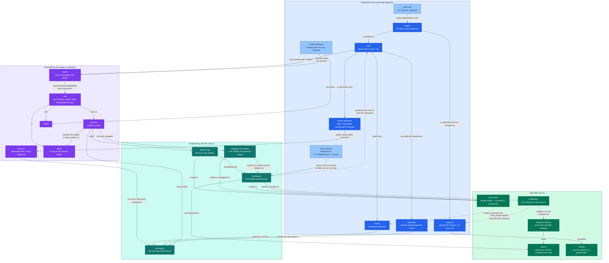

# Glossary

The **ubiquitous language** of this project: every domain term with its one canonical
name. Code identifiers, documentation prose and conversation all use these terms.

Two standing obligations, restated in [AGENTS.md](AGENTS.md):

- **Use these names.** New identifiers, docs and prose use the canonical term here, never
  an ad-hoc synonym.
- **Keep it current.** When a new domain term enters the code, add it here in the same
  change.

| Term | Meaning |
|------|---------|
| case | One `@evalcase` function in an `eval_*.py` module: a task, at most one skill, a fixture or a fixture generator, a matrix. A *skill case* names `skill=`; a *scenario case* does not (ADR 0074) |
| scenario case | A case that names no skill. Its task is sent verbatim to every harness through `Harness.prompt`, no skill is registered with the CLI, and its records carry no skill coverage or skill use: it measures how an agent copes with what the fixture sets up, such as a linter's findings to clear (`CaseKind.SCENARIO`, ADR 0074) |
| subject | What a case measures: the directory its suite's `evals/` sits under, the skill or the tool a scenario exercises. Records keep it under the `skill` key, the first level of the captured tree, beside `kind` (`skill` or `scenario`) (ADR 0074) |
| subject version | The digest of the paths a case `tracks=`, recorded on every record as `subject_version`, so the Analyzer compares versions of the subject. A skill case tracks its skill directory less `evals/` by default; a scenario case without `tracks=` records none (`model/workspace.py` `version`, ADR 0074) |
| task | What a case declares: the sentence a user types *after* naming the skill. It never names the skill, a CLI, or a loading path -- each harness renders its own invocation around it, and the same task therefore produces a different prompt per arm (ADR 0044) |
| invocation | How one harness names a skill to itself: `/<skill> <task>` for `claude` (registered for the session with `--plugin-dir`), `$<skill> <task>` for `codex` (registered under the private `CODEX_HOME/skills/`). `Harness.invoke` is the only place either is spelled; `model/registry.py` is the one edge that asks from beneath (ADR 0011, ADR 0044) |
| EvalSuite | One imported `eval_*.py` module and the cases it declares. A suite belongs to no package, so it is imported by path under a name derived from that path; `EvalSuite.load` and `find_case` are the one loader collection and a replay share, where each used to keep its own (`model/suite.py`, ADR 0040) |
| cell | One (harness, model, effort, treatment) point of a case; the unit pytest collects, runs, and reports. Its id is `harness/model[/effort][+treatment]` |
| cell plan | What collection resolves for one cell, once, and freezes: the case, scenario, matrix point and repeat, the subject and its version, the suite as records name it, the fixture directory, the treatment overlays and the skill's catalogued files. The pytest item, the dry-run preview and the live run all read it; its prompt and case reference are derived from it. `CellPlan` in `runtime/plan.py` (ADR 0076). |
| harness | The agent CLI a cell runs on, `claude` or `codex`; the first half of a cell id |
| matrix | The list of `harness/model` or `harness/model/effort` entries a case expands into cells; three scopes, case over project over plugin; `--harness`, `--model`, `--effort`, `--treatment` and `-k` narrow it. The plugin default is every catalogued model whose output rate is below `xharness_output_rate_limit` (ADR 0058) |
| model catalogue | Every supported model, in one config file: `derive/prices/models.toml`, beside the price records. One table per harness names its LiteLLM `feed_provider` and lists its models with `line`, `tier` and `released`; `derive/catalogue.py` reads it into `ModelSpec`s. Its `excluded` table names each priced model left out on purpose, with a reason; a priced first-party model that is neither catalogued nor excluded is *undecided* and stops `make prices`. A matrix entry naming an uncatalogued model is a collection error; `xharness_models` ini lines add or correct one before a plugin release (ADR 0057, ADR 0059, ADR 0067) |
| live pricing | Pricing a matrix entry that no price row covers by looking it up in LiteLLM's feed (`xharness_price_feed`) at collection, by exact first-party id. What it finds is saved as a dated record under `<cache>/pricing/`, which the sweep and every later replay read; an entry the feed cannot price either still stops the sweep (ADR 0060) |
| line | A model's product line in its provider's lineup: `haiku`, `sonnet`, `opus`, `fable`, `luna`, `terra`, `sol`, `astra`. Stored on every record (ADR 0057) |
| timed out | A run whose CLI was killed at `xharness_timeout_s`. Its partial session is captured and priced; it fails if its logs were written within the 5 minutes before the kill (it ran out of time) and errors if they had been silent longer (it stalled) (`RunResult.timed_out_after_s`, `idle_before_timeout_s`, ADR 0064) |
| attempted | A run whose CLI exited cleanly or made at least one model call (`RunResult.attempted`). An unattempted run (a session limit, an expired login, a refused request) is graded an error before its grader runs, never a fail of the skill (ADR 0063) |
| family tier | A hand-curated integer for a model's role in its provider's lineup, 1 the smallest; today 1 is Haiku and Luna, 4 is Fable and Astra. A number rather than a name, so it survives a lineup change; a role, never a price; frozen at release, so history stays comparable. The cross-provider bucket: "every tier 3 model" (ADR 0057) |
| released | A model's release date, `YYYY-MM-DD`, stored on every record. A generation format derived from it is not yet decided (ADR 0057) |
| effort | The reasoning budget a cell asks its CLI for: the third matrix axis, and the optional third component of an entry. An entry that names none leaves the CLI on its own default (ADR 0049) |
| rung | One level of a harness's own effort ladder (`Harness.efforts`, lowest first). Both shipped harnesses declare `low, medium, high, xhigh, max`; the ladder is per-harness, not shared. A matrix entry may name a rung exactly, and a rung the named harness lacks is a collection error, never the nearest one (ADR 0049) |
| alias | A portable effort word naming a *position* rather than a level: `min`, `mid`, `max`. It resolves against whichever ladder the harness has, once, at matrix expansion -- so one line sweeps both arms at comparable intensity and nothing downstream ever holds a word the CLI would not understand (ADR 0049) |
| skills root | The directory under the rootdir holding `<skill>/evals/` trees; ini key `xharness_skills_dir` |
| fixture | A committed seed directory under `evals/fixtures/<name>/` that a workspace is copied from; several cases may share one. `fixture=` may instead name a fixture generator (ADR 0074) |
| fixture generator | Python that yields scenarios, passed as `@evalcase(fixture=...)`; each scenario becomes its own set of cells. The shipped ones are `Table`, `Generated`, `from_dir`, `Promoted` and `Adversarial` (`model/generators.py`, the protocol `FixtureGenerator` in `model/scenario.py`, ADR 0074) |
| scenario | One generated fixture: a file tree, the JSON-able `params` that made it, its expectations (the grader reads `output.scenario` and `output.params`), and an optional task of its own. Its id is a slug plus a digest of generator, version and canonical params, and joins the node id as `eval_x[<scenario id>/<cell id>]`. Written once at collection to `<cache>/scenarios/<suite path>/<case>/<id>/`, the suite path relative to the project root, with `<id>.provenance.json` beside it, and materialised from there (ADR 0074) |
| scenario store, provenance | A directory of scenario trees, each with its `<id>.provenance.json` beside it (`ScenarioStore`, `Provenance` in `model/scenario.py`): the cache's per-case store, and a suite's `evals/fixtures/` once a failure is promoted into it (ADR 0076). |
| fingerprint | The digest of a scenario's bytes, recorded on every run of it as `scenario_fingerprint`. Two records of one id with different fingerprints measured different inputs and never pool; a generator whose output changes for the same params bumps its `version` (ADR 0074) |
| Draw | A seeded source of choices for a generator, seeded from a sha256 digest and drawing only through `random.Random.random`, so the same seed draws the same scenarios on every machine and Python release (`model/scenario.py`, ADR 0074) |
| adversarial generator | A fixture generator that hunts for scenarios that break the subject on a budget of tens of runs: it *confirms* stored past mutants that failed, *explores* new mutants of its seed scenarios weighted toward parents that failed, and *screens* each through an oracle (`Adversarial`, ADR 0074) |
| mutator | A function `(files, draw) -> files` an adversarial generator composes onto a seed scenario; the shipped text mutators (`TEXT_MUTATORS`: CRLF, trailing whitespace, zero-width, NBSP, duplicated or shuffled paragraphs, no final newline) change how a document is encoded or arranged, never what it says (ADR 0074) |
| oracle | A free, deterministic check of a file tree returning the set of signals it raises, such as a linter's rule ids. An adversarial generator keeps a mutant only if its signal set is non-empty and new to the sweep, so the paid budget goes to inputs that differ in kind (ADR 0074) |
| promotion | Freezing a stored scenario, or the scenario a failed session ran on, into `evals/fixtures/<name>/` with `uv run -m pytest_xharness_eval.promote`. It copies bytes, never params, with provenance beside the fixture; `Promoted` runs every promoted fixture and refuses one whose bytes no longer match their fingerprint (`promote.py`, ADR 0074) |
| expectation | A grader knob a scenario carries in `expect`, beside its `params`: a recall threshold, a length ratio. Kept out of the scenario id, so tuning a tolerance keeps the scenario's history whole; a key may not be both, and the grader reads the two merged as `output.params`. `Table(expect=[...])` names the row keys that are expectations (`Scenario.expect`, ADR 0074) |
| precheck, Seed | A case's gate on its input, `@evalcase(precheck=...)`: a function over the `Seed` (the materialised workspace, any treatment over it, and its scenario) that raises when the seed no longer sets up what the case is about. It runs after materialising and before the paid invoke, so a raise errors the cell as a `RunError` with nothing billed; under `--dry-run` it runs too, so every fixture is checked for free (`model/output.py`, ADR 0074) |
| treatment | A committed overlay directory under `evals/treatments/<name>/`, plus an optional `<name>__<harness>/` dialect directory copied last, layered over the fixture to change what the agent finds in its workspace (an `AGENTS.md`, a `CLAUDE.md`). The opt-in fourth matrix axis: a case names treatments with `treatments=` or inherits `xharness_treatments`, and the default is none. A treatment with no files for a harness it is swept on is a collection error (ADR 0055) |
| control | The untreated cell, and the reserved word that names it in `--treatment` and on the report. Every treated case also sweeps its control, so a treatment is always measured against the same cell without it (ADR 0055) |
| workspace | The per-cell copy of the fixture, with any treatment copied over it, under the work directory that the agent works in. Removed with its harness run directories once the cell's evidence is captured and graded, unless `xharness_keep_workspaces` keeps it for inspection (ADR 0062) |
| session log | The JSONL file the CLI writes for one session; the evidence a verdict is tied to |
| Harness | The class behind a harness name: how its CLI is invoked, how its log correlates back to the run, how its records classify, and what its shell tools mean for coverage. `harness.get(name)` is the only way to reach one; an unregistered name raises rather than defaulting (ADR 0034) |
| SessionLog | One captured session in a provider's dialect *plus the side-channel that dialect needs* -- Claude's stdout envelope, Codex's exit code -- so every caller gets one uniform `to_result` (ADR 0034) |
| RunResult | The normalised record of one cell: identity, usage, tool calls, files written, cost. `RunResult.folded(calls, subagents, ...)` is the one constructor an adapter builds one through, so `turns` and `usage` are derived from the ledgers rather than supplied (ADR 0035) |
| Usage | Token counts normalised across both dialects and kept apart by billed tier, for one call, one subagent, or a whole run. Frozen: a total accumulates only by producing a new total (`+`, `Usage.total`), so "a run's usage is its whole bill -- the primary ledger plus every subagent" is an invariant of the type rather than a rule the caller has to remember, and a second fold cannot bill a subagent twice (ADR 0033, ADR 0035) |
| CaseOutput | What one rollout left behind, as a grader sees it: the `RunResult` and the workspace, with the accessors every suite kept re-deriving (`read`, `wrote`, `added`, `changed`). A grader takes exactly one of these; the two positional arguments it replaced were never two things (`model/output.py`, ADR 0045). Its whole surface is `docs/rollout.md` |
| verifier | A plain function over a `CaseOutput` that returns when its claim holds and raises `AssertionError` naming what went wrong when it does not. Also called a *checker*; bound to its arguments it is a `Checker`, and `check_all` runs many and reports every failure. The shared ones ship in `verify/`: `checks.py` (evidence and artifacts), `conduct.py` (budgets and behaviours over the run record), `content.py` (the file against its seed), `tool.py` (the tool under test, whose failure to run raises `RuntimeError` and grades `error`) and `combine.py`; anything else is still Python beside the case (ADR 0012, ADR 0013, ADR 0045) |
| golden | A committed, correct artifact at `evals/goldens/<name>/<path>`, mirroring `evals/fixtures/<name>/<path>`. A `GoldenCase` compares a candidate to it facet by facet, each `Facet` declaring a `Tolerance` -- `Exact`, `Superset`, `Jaccard`, `Ratio`, `Count`, `Within` -- and a mismatch reports the per-facet delta rather than a diff (`verify/golden.py`, ADR 0046) |
| CaseRef | The case a result names -- suite, name, skill (the subject), fixture, task, prompt, kind, and for a generated fixture its scenario id, fingerprint and params, and the subject version -- as one type for the live cell and both replay paths, which used to hand-build the record three times; the `case` block of `result.json` (ADR 0025, ADR 0035) |
| CostEstimate, AppliedRates | What one run costs under one price row: `CostEstimate.of(calls, rates)` prices each call at its own tier and returns the total, the per-tier split, the long-context call count and the provenance, and `RunResult.apply_cost` writes all of it in one call, so the cost fields are never written apart. `AppliedRates` is the `Rates` row plus its `unit` (`usd_per_mtok`), its interval, its long-context tier and the `applied_at` stamp, and is the `rates_applied` block of `result.json` (ADR 0021, ADR 0035, ADR 0050, ADR 0051) |
| long-context tier | The rates a call is billed at, for the whole call, once its prompt (input plus cache read plus cache write) is over a row's `above_prompt_tokens`; a `long_context` sub-table in a record, `long_*` keys on an `xharness_prices` line. Evaluated per call, never on a run's summed usage (`LongContext`, ADR 0051) |
| price record | One bundled `derive/prices/prices-YYYYMMDD.toml`: the rows in effect over one *effective interval*, grouped by harness, in USD per million tokens. The name carries its `effective_from`; the one record still in effect has no `effective_to`. A price change adds a record rather than editing one, so the directory is the price history (ADR 0050) |
| effective interval | When a price row held: `[effective_from, effective_to)`, half-open, so consecutive records meet on a boundary day that belongs to the newer one. A run is priced from the row whose interval covers the day its `{run}` stamp names; a day no row covers is unpriced, never zero (ADR 0007, ADR 0050) |
| Rates, PriceTable | One price row keyed by `(harness, model)` with its effective interval and optional long-context tier, and every row a sweep may price from -- the project's `xharness_prices` lines first, then the bundled records -- looked up by `(harness, model, day)` (`derive/pricing.py`, ADR 0050, ADR 0051) |
| CostStatus | `priced` or `unpriced`, with no third state (ADR 0007); a `StrEnum`, so the wire format carries the same bare word it always has (ADR 0035) |
| Verdict | How a cell graded: `pass`, `fail`, `error` or `dry-run`, and no fifth. A domain noun in `model/verdict.py`, so every layer that names one -- the cell that decides it, the record that stores it, the status word that prints it -- spells it from the same place; `Outcome.verdict` is declared as it, while the record keeps the `.value`, because that record crosses execnet, which serialises builtins only. `Verdict.stored` reads a word no version of this package wrote as *no* verdict rather than a fabricated grade (ADR 0016, ADR 0038, ADR 0041) |
| pipeline | The single sequence run over a `RunResult` by both a live cell and a replay: derive (price, coverage, case), capture (log, subagents, result), record metrics; `runtime/pipeline.py` (ADR 0034, ADR 0039) |
| settings | One resolved view of a project's configuration, built either from the live `pytest.Config` or, for a replay, from the pytest config on disk; `runtime/settings.py` (ADR 0034, ADR 0039) |
| CellRun, Attempt | One cell's live run as a small state machine: materialise the workspace, `invoke` the CLI, `store` (derive then capture), `grade`, `record`. Exactly one of those steps spends money, and it is the only one carrying `pragma: no cover`, so the sequence a replay is pinned against is testable without paying (`plugin/cell.py`, ADR 0002, ADR 0040). An `Attempt` is what one invocation produced plus the two clock facts no log carries |
| CacheLayout, SessionDir, LocatedSession | The cache tree as a value object, and one session's evidence directory within it. `CacheLayout` owns `build/`, `results/`, `report/`, every file name under them and the five-level `sessions()` walk; `SessionDir` owns `log.jsonl`, `result.json`, `history.json` and `subagents/`. `LocatedSession` is a `SessionDir` that knows its five coordinates, and therefore the only one that can be named by `rel` or linked to from the page; only `CacheLayout` builds one (ADR 0038). `Settings.cache` is a `CacheLayout`, so nothing reassembles a path under the cache root (ADR 0032, ADR 0037) |
| captured | `<cache>/results/{skill}/{harness}/{model}[--{effort}][+{treatment}]/{run}/{session}/`, where each run's log, `RunResult` and metrics record are written; git-ignored. Five levels deep whether or not a rung or a treatment was named -- both share the model's level rather than adding one (ADR 0032, ADR 0049, ADR 0055) |
| CellMetrics, Outcome | One graded cell's metrics record -- the `history.json` written beside its evidence and one line of the combined `report/history.jsonl` -- as a type: flat, built of builtins, and carrying `status_word()` and its own `cache` field. `Outcome` is the values grading observed and no log can supply (node, verdict, wall clock, start, and the `failure` line saying why a cell did not pass), which a replay carries forward while recomputing everything else. The record crosses to the xdist controller as a plain mapping and is a type on both sides; `from_dict` drops an unknown key *and* a value that is not of its field's declared type, so every reader may trust the declaration (ADR 0016, ADR 0018, ADR 0037, ADR 0038) |
| history | One `history.json` per session (turns, tool calls, duration, wall clock, USD, tokens), combined into `<cache>/report/history.jsonl`; git-ignored with the rest of the cache (ADR 0032) |
| Important Metrics | The measures a cell is judged by beyond pass or fail: cost, billed tokens, peak context, cache-read share, subagents and their shares of tokens and cost, compactions, turns, whether the skill triggered, skill files loaded and scripts run, thinking share, throughput, time to first token, wall clock, the pass rate and the error rate. Declared once as `IMPORTANT_METRICS` in `model/metrics.py` (`ImportantMetric`: an `id`, the history `field` it reads, optionally a `per` denominator, a `MetricKind`, a `Unit`, and for a rate the verdict it `counts`), so `emit/`, the report and this glossary read one list (ADR 0071). An `error` is no sample of the pass rate, only of the error rate |
| sample | One graded session of a cell: its verdict is `pass`, `fail` or `error`. Repeated runs of a cell are repeated samples of one experiment, reduced together; a dry run, or a record whose verdict this version cannot read, is no sample (ADR 0071) |
| repeat | One of the N samples `--xharness-repeat N` collects of every cell in one sweep, its node id suffixed `#1` to `#N`. A repeat is another sample of the same cell, so its record keys the cell exactly as a single run does; five per arm is the least at which a comparison can reach significance with room for a correction across cells (ADR 0075) |
| analyzer | A checker over every sample: an `analyze_*(analysis)` function a suite declares with `@analyzer` (optionally `cases=`), which fails by raising `AssertionError`. It sees only its own suite's records, matched by suite path, and runs at `pytest_sessionfinish` on the controller, or free with `uv run -m pytest_xharness_eval.analysis <cache>` (`AnalyzerSpec` in `model/findings.py`, ADR 0075) |
| analysis | The `Analysis` an analyzer is handed: the cache's history plus this sweep's records, each session once, with the questions it may ask of them. The environment as the variable (`summarise`, `effects`, `best`, `pareto`, `tiers`), the subject as the variable (`versions`, `compare`, `trend`, `regressions`), the scenario as the variable (`fragile`, `failures`), and `expect_*` helpers that fail with evidence. Every resample takes its `seed`; every group under `min_n` samples is insufficient (`analyze/questions.py`, ADR 0075) |
| finding | What one analyzer concluded: `passed`, a message, the comparisons behind it, and the notes it published. A broken analyzer is a failed finding whose message starts `ERROR`, never an internal error. `report/analysis.json` (`AnalysisReport`, `emit/findings.py`) holds one per analyzer, named `<suite path>::<analyzer>`, and a failed one fails the session (ADR 0075) |
| unmeasurable | What a checker raises when it cannot measure what it was asked to (a tool that did not start, a report that did not parse, a fixture that no longer reproduces its rule). `Unmeasurable` is a `RuntimeError`, so the cell grades `error`, not `fail`: `Verdict.of_exception` gives `fail` to a failed assertion alone, for a grader, a precheck and an analyzer alike (ADR 0076). |
| estimate | A point with its interval, the `n` behind it and the `method` that made it (`wilson` for a rate, a bootstrap of the kind's centre otherwise). An empty group's point is None, never invented (`Estimate`, ADR 0075) |
| comparison, change | A candidate against a baseline on one metric within one matched cell: both estimates, the difference, P(better), and the p-value and its Benjamini-Hochberg q-value. Its `change` is one of four words and no fifth: `improved` or `regressed` only when the q-value clears and the difference's interval excludes zero, `insufficient` below `min_n` on either side, `inconclusive` otherwise (`Comparison`, `Change`, ADR 0075) |
| note | A value an analyzer publishes on its finding with `analysis.note(key, value)`, kept whether the analyzer passed or failed, so a hill-climbing loop reads the front and the estimates rather than only the verdict (ADR 0075) |
| aggregate, MetricKind | What a cell's samples reduce to, fixed by the metric's kind: `spread` (median, p25, p75), `fraction` (mean, min, max), `rare` (mean, share of samples with any) or `rate` (pass rate with its Wilson 95% interval), each with `n`, the samples that recorded the metric. A sample that did not record it drops out of `n`, never counted as zero. `emit/samples.py` reduces every cell into `index.json`'s `important_metrics` (ADR 0071) |
| compaction | The harness summarising a session's conversation to free the context window: a `compaction`-category record kind, counted per run into `compactions` (ADR 0071) |
| call, turn | One model API call inside a cell's session (a *SessionTurn* in the report); `RunResult.calls` is the ledger of them, each with its usage, tools issued, results fed in, text, thinking, and the log lines it came from (ADR 0019, 0021). `turns` counts them; the CLI's own count is `reported_turns` |
| executed command | One shell command the harness itself reports as having run, after its own expansion: `call.executed` is the list of them, each with the `tool` the harness named the record, the `command` string and the `cwd` it ran in. Codex's `CommandExecution` item is one; Claude Code logs none, so its list is empty. Skill coverage attributes from it beside the tool call, because it is the one text every wrapper language and shell variable has already been resolved out of (ADR 0048) |
| subagent | A thread the session spawned, at any depth (Claude's Agent tool sidecars under `subagents/`, Codex's forked rollouts), captured beside `log.jsonl` and folded through the same ledger; `RunResult.subagents` lists them, each attributed to the primary turn it descends from (`parent_turn`), and their usage is inside the run's `usage` and estimate (ADR 0033). Each is linked one to one to its spawn record (`spawned_by`, `parent`, `depth`) and carries its span (`started_at`, `ended_at`); a thread the evidence cannot pair with a spawn is a `SubagentMismatch`, never a guess (ADR 0072) |
| unfolded run | A billed run whose logs exist but will not fold, such as one with a subagent its spawn records cannot account for. The harness raises `UnfoldedRun` carrying its `Evidence`; the cell copies the logs into the session directory with an `unfolded.json` in place of `result.json`, so the report skips it and a replay retries it (ADR 0072) |
| spawn record | The record a thread logs when it spawns a subagent: Claude's `Agent` tool call, Codex's `CollabAgentToolCall` item or direct `spawn_agent` call. `harness/threads.py` pairs each with exactly one transcript (ADR 0072) |
| estimated cost | `estimated_cost_usd`: this plugin's price-table estimate; `rates_applied` records the rates, row and file behind it (ADR 0021) |
| harness reported cost | `harness_reported_cost_usd`: what the harness CLI itself said the run cost; Claude only |
| total tokens | Every priced token summed over all turns; the cached prefix counts once per turn |
| baseline tokens | The first turn's context: the harness's own prompt before the agent acts |
| report, IndexRow | `<cache>/report/`: `report.html` with `index.json`, `history.jsonl`, `report.tokens.json` and `XHARNESS-REPORT-GLOSSARY.md` beside it -- a static page over the captured JSON, served over HTTP (ADR 0020, 0021, 0032). `IndexRow` is one row of `index.json`: a session summarised from its stored `result.json` and metrics record, with its evidence addressed by relative path (ADR 0037) |
| RunSummary | `report/report.json` as a type: the cells one pytest session graded and the estimate they add up to, plus `cache_roots()` -- the roots this session wrote evidence into, which is where the combine step's trigger is decided and why a dry run stays free (`emit/summary.py`, ADR 0037, ADR 0040) |
| LegacyCapture | A pre-0032 `<skill>/evals/captured` directory, recognised by shape and migrated into a cache root; transitional code with a known end, kept in one file so it can be deleted in one (`runtime/legacy.py`, ADR 0032, ADR 0040) |
| SessionId, SessionTurnId | How the report addresses a session (the harness-minted session id, a unique prefix accepted) and a turn (`<SessionId>/t<N>`); both copyable from the page and carried in its URL fragment |
| record kind | The catalogued shape of one session-log line, `harness/type[/subtype]`, with a category that colours its pill in the report; each harness's `classify_record` names the kind, `harness/records.py` is the catalogue, and `record_kinds` is the per-run census (ADR 0022, ADR 0034) |
| tool cost, skill use | A tool call's time and its two attributed costs: `issuing_cost_usd`, the call that asked for it split across its tools, and `context_cost_usd`, its result's share of every later prompt that carried it, with a per-turn trace and a count of cache re-reads. A skill use is the skill under test's span, from its first trigger to its last touch, with the costs of the tool calls that touched it; `derive/toolcost.py` (ADR 0073) |
| skill coverage | Which of the skill's catalogued files a run loaded or ran, per turn, and the `not_loaded` / `not_run` sets; `derive/skillcov.py` (ADR 0022). What the project's `xharness_skill_ignore` lines mean, and which files they take off the decision surface, is `derive/ignorerules.py` (ADR 0026, ADR 0035) |
| SkillFile, FileCoverage | One catalogued file of the skill -- path, `FileKind` (doc, script, test, asset), bytes, sha256, ignored -- and that file widened by the turns that loaded or ran it, one list per `Access`. The row widens the record rather than nesting it because the wire format is one flat row per file in `skill_coverage.files` (ADR 0022, ADR 0035) |
| CoverageSummary, SkillCoverage | The counts and denominators the metrics record and the report row read, and the whole coverage answer for one run. `SkillCoverage.over` derives the four path sets and the summary from the annotated rows in one place, so they cannot disagree with each other or with `files` (ADR 0022, ADR 0035) |
| IgnoreRules | The `xharness_skill_ignore` lines that apply to one skill, compiled once at collection into the gitignore-pattern subset that `matches(rel)` answers. It knows nothing of skills, runs or harnesses, and a malformed line raises at configure time rather than silently measuring nothing (ADR 0026, ADR 0035) |
| context window | The model's window as the harness reported it; `context_window_pct` (peak turn) and `final_context_pct` are measured prompt sizes over it, never estimates (ADR 0024) |
| design tokens | `report.tokens.json`: the palette, series, pill colours and fonts the report is themed with; bundled, copied beside every report, overridable per project (ADR 0024) |

## How the terms relate

The table defines each term; the map below shows how they hang together across a
run's lifecycle. Hue encodes who produces the thing: blue is declared in the
consuming repository, violet is computed by the plugin at collection, teal is
evidence produced by a live run, emerald is what survives the run. The light blue
nodes are configuration rather than code.

Read it top to bottom as one cell's life: a case declared beside its subject is
expanded against the matrix, and against each scenario its generator yields, into cells; each cell copies the fixture into a fresh
workspace, runs its harness there, and the harness's own session log becomes the
`RunResult` the case function grades. The dashed edges are the only ones that point
back up: grading closes the loop between evidence and the case that asked for it,
promotion turns a failure the evidence holds into a committed fixture, and an analyzer
declared beside the cases reads every stored sample once the sweep ends.
